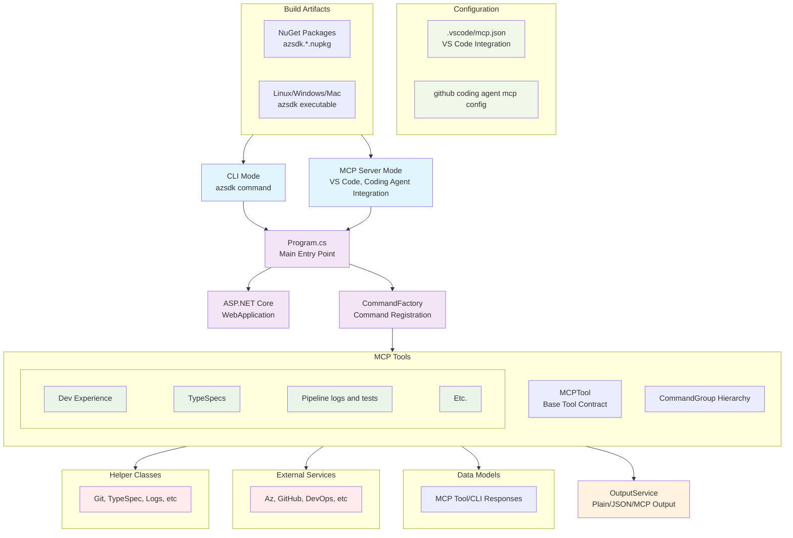

# Azure SDK CLI and MCP server

This project is the primary integration point for all `azure-sdk` provided [MCP](https://modelcontextprotocol.io/introduction) tools as well as a convenient CLI app for azure sdk developers. It is built and published out of the `azure-sdk-tools` repo but consumed primarily through the `.vscode/mcp.json` file within each `Azure-sdk-for-<lang>` language repository. Server installation is carried out by the eng/common scripts present at `eng/common/mcp/azure-sdk-mcp.ps1`.

## Table of Contents

* [Azure SDK CLI and MCP server](#azure-sdk-cli-and-mcp-server)
   * [Table of Contents](#table-of-contents)
   * [Getting Started](#getting-started)
      * [Install standalone](#install-standalone)
      * [Prerequisites](#prerequisites)
      * [Setup](#setup)
      * [Build](#build)
      * [Run](#run)
      * [Package information](#package-information)
      * [Package release approval](#package-release-approval)
      * [Test](#test)
      * [Test with GitHub Coding Agent](#test-with-github-coding-agent)
      * [Release](#release)
   * [Project Structure and Information](#project-structure-and-information)
      * [Directory Structure](#directory-structure)
      * [Architecture Diagram](#architecture-diagram)
      * [Pipelines](#pipelines)
   * [Design Guidelines](#design-guidelines)
   * [Adding a New Tool](#adding-a-new-tool)
   * [Data Collection](#data-collection)
      * [Telemetry Configuration](#telemetry-configuration)

## Getting Started

### Install standalone

**To use the CLI immediately** (not intended for development), run the installation script:

```pwsh
<repo root>/eng/common/mcp/azure-sdk-mcp.ps1
```

To add the CLI tool to your shell path, run this instead:

```pwsh
<repo root>/eng/common/mcp/azure-sdk-mcp.ps1 -UpdatePathInProfile
```

The tool can now be run by typing `azsdk` into the shell.

**To use the MCP server immediately**

See the [mcp quick start docs](https://github.com/Azure/azure-sdk-tools/blob/main/tools/azsdk-cli/Azure.Sdk.Tools.Cli/README.md#quick-start).

### Prerequisites

- [.NET 8.0 SDK or later](https://dotnet.microsoft.com/download)

### Setup

1. Clone the repository:
    ```sh
    git clone https://github.com/Azure/azure-sdk-tools.git
    cd azure-sdk-tools/tools/azsdk-cli
    ```

2. Restore dependencies:
    ```sh
    dotnet restore
    ```

### Build

To build the project:

```sh
dotnet build
```

### Run

To quickly run local changes in CLI mode:

```sh
dotnet run --project Azure.Sdk.Tools.Cli -- --help
```

See the [development docs](https://github.com/Azure/azure-sdk-tools/blob/main/tools/azsdk-cli/Azure.Sdk.Tools.Cli/README.md) for more detailed instructions on how to run this tool as an MCP server or CLI app.

On Windows, run `azsdk.bat <arguments>` from this directory. The launcher first stops this repository's running `azsdk.exe` MCP servers to release build-output DLL locks, including servers started with global `--debug` or `--output` (`-o`) options before `mcp` or `start`. Cleanup diagnostics go to stderr. It then forwards all arguments to `dotnet run --project Azure.Sdk.Tools.Cli --` and returns its exit code. This disconnects those MCP servers; unrelated processes and other repository copies are left running.

Run the launcher regression tests on Windows with `powershell.exe -NoProfile -Command "Invoke-Pester .\tests\azsdk.Tests.ps1"`.

### Package information

Inspect a local SDK package, including the API versions recorded in generated metadata:

```sh
azsdk eng package-info --package-path <package-root> --output json
```

The language is inferred from the SDK repository. Single-package mode calls the language service's `GetPackageInfo` and returns the package in `result`, including `Name`, `Version`, and `ApiVersions`. Plain output also displays the package as JSON. It does not scan other packages or populate bulk CI enrichment fields.

To also identify resource types from the package's pinned specification, use:

```sh
azsdk eng package-info --package-path <package-root> --include-resource-types --output json
```

This returns the same `PackageInfo`, with `ApiVersions` and `ResourceTypes`.
The same package also carries the validated `TypeSpecLocation` (directory,
repository, and commit), `MetadataFiles`, and `MetadataIssues`; its
existing `SdkType` identifies management (`mgmt`), data plane (`client`), or
unknown. Per-package generation and enrichment operations return `PackageInfo`
directly, not a second result model containing a package.
Each resource-type entry has `Namespace`, `ApiVersion`, and `ResourceType`, so
one package can represent several RPs and different versions without mixing
their resource types. For example:

```json
{
  "ApiVersions": [
    {"Namespace": "Microsoft.Compute", "Version": "2025-01-01"},
    {"Namespace": "Microsoft.Network", "Version": "2026-01-01"}
  ],
  "ResourceTypes": [
    {"Namespace": "Microsoft.Compute", "ApiVersion": "2025-01-01", "ResourceType": "virtualMachines"},
    {"Namespace": "Microsoft.Network", "ApiVersion": "2026-01-01", "ResourceType": "virtualNetworks"}
  ]
}
```

Resource-type enrichment requires GitHub access to the recorded spec revision,
but makes no ARM requests and does not require Azure authentication. Without
`--include-resource-types`, inspection remains local metadata-only and
`ResourceTypes` is empty because it was not resolved. The option requires one
`--package-path`; it cannot start an implicit bulk network scan. Missing or
unresolved generation/resource evidence makes an enrichment request fail rather
than returning partial evidence as complete.

Add `--out-dir <directory>` to write the selected package's CI-format JSON file instead of returning the package directly. Without `--package-path`, the existing bulk-export mode still requires `--out-dir` and supports `--repo-root`, `--service-directory`, `--artifact`, and `--ci`. Those bulk-selection options cannot be combined with `--package-path`. `--add-dev-version` is supported in both modes.

API versions are populated during SDK package discovery for these languages:

| Language | Metadata path relative to the package root | API version fields |
| --- | --- | --- |
| Java | `src/main/resources/META-INF/*_metadata.json` | `apiVersions` map, falling back to `apiVersion` string |
| JavaScript | `metadata.json` | `apiVersions` map, falling back to `apiVersion` string |
| Python | `_metadata.json` | `apiVersions` map, falling back to `apiVersion` string |
| Go | `testdata/_metadata.json` | `apiVersions` map, falling back to `apiVersion` string |
| .NET | `metadata.json` | `apiVersions` map, falling back to `apiVersion` string |

Discovery reads only these metadata locations, not nested packages or SDK source code. `ApiVersions` contains objects with `Namespace` and `Version`, preserving each namespace from the metadata map. When the map is absent or empty, discovery falls back to the singular `apiVersion` field and omits `Namespace` for that entry. A populated map takes precedence over the singular field in all languages. Version strings are trimmed, identical namespace/version pairs are deduplicated, and entries are sorted by namespace then version in ordinal order. Different namespaces sharing a version remain separate entries. Java combines all matching files. The existing internal `ApiVersion` property remains exclusive to the TypeSpec/release-plan flow.

For example, map metadata produces `"ApiVersions": [{"Version": "2026-04-01", "Namespace": "Compute"}]`; singular metadata produces `"ApiVersions": [{"Version": "2023-01-01"}]`.

Missing metadata or metadata without API versions leaves `ApiVersions` empty. Malformed JSON, invalid field types, blank version strings, or unreadable files leave it empty and log a warning with the file path and failure reason. No partial versions are returned if a matching file is invalid. Metadata errors are logged only; they are not stored in `PackageInfo` and do not fail package discovery or hide the package from bulk export. Invalid command options, nonexistent package directories, or failed package lookups return exit code `1`.

### Service API-version readiness

```sh
azsdk pkg check-api-version --pull-request-url https://github.com/Azure/azure-sdk-for-java/pull/123 --output json
azsdk pkg check-api-version --package-path <package-root> --output json
```

For a current-head metadata inspection without ARM requests, use
`azsdk pkg check-api-version --pull-request-url <sdk-pr-url> --metadata-only --output json`.
This CLI-only option resolves package provenance and pinned resource requirements
without Azure credentials. It returns metadata with an Inconclusive readiness
status, not a passing service observation. Automation can compare that evidence
with release-plan state before deciding whether a full ARM check is needed.
Metadata-only mode requires PR input and retains the captured-head contract.

Release-plan reuse is handled by the CLI coordinator using the existing ADO
service. Set `AZSDK_SERVICE_READINESS_FIELD`, `AZSDK_SERVICE_READINESS_ENVIRONMENT`,
and `AZSDK_SERVICE_READINESS_MAX_AGE_SECONDS` to enable optional cache reads. Plan
association and project/commit values come from the existing work item, not copies
in the readiness payload. Existing ADO change history invalidates older evidence.
An unconfigured or unavailable cache falls back to the stateless ARM check.

Add `--record-release-plan` with PR input to explicitly allow revision-safe ADO
persistence after a fresh check. This CLI-only option is incompatible with local
package input and `--metadata-only`; the MCP check and normal CLI invocation do
not write ADO. The JSON stores only Resource Provider, API version, status, matched
resource types, validation environment, and check time. No project, commit, entry
ID, explicit expiry, or diagnostic values are duplicated.

Supply exactly one of `--pull-request-url` or `--package-path`. The MCP tool
`azsdk_check_service_api_version` accepts the same alternatives:

```json
{"pullRequestUrl": "https://github.com/Azure/azure-sdk-for-java/pull/123"}
```

```json
{"packagePath": "/path/to/azure-sdk-for-java/sdk/storage/azure-resourcemanager-storage"}
```

The CLI and MCP entry points share one read-only check. It resolves exact generation metadata from the SDK
files at the current PR head or the selected local package, enriches `PackageInfo`
from the pinned specification, and compares its RP/version/resource-type entries
with ARM provider metadata. It returns Passed, Not detected,
Inconclusive, or Error with package, source, and resource-type evidence. It does not edit
GitHub, grant permissions, merge a PR, or release a package.

In PR mode, the command captures the SDK PR head SHA. Callers must
compare that SHA with the current head before publishing a result. It does not
accept a caller-supplied SHA. The same captured-head rule applies to MCP results.

Local mode reads the selected working-tree files, including uncommitted changes,
and returns `inputKind: "package"` with no PR head SHA. It is not a PR-head
attestation and must not be used by the automation worker to publish a PR result.
The worker continues to invoke PR mode. No SDK files are modified in either mode.

GitHub authentication uses the existing token resolver: automation can supply
its App installation token through `GITHUB_TOKEN`; local users can use
`gh auth login`. ARM uses the existing Azure credential service, including
developer credentials locally and managed identity on the hosted worker.
Do not pass either token on the command line.

The resolver tries `GITHUB_TOKEN`, legacy `GITHUB_PERSONAL_ACCESS_TOKEN`, then
`gh auth token`. A rejected supplied token does not switch identities. Token
discovery does not log process output, and failures exclude stdout and stderr.

The command is a draft implementation until review and a CLI release are complete.
Consumers need a release containing it or a validated trusted artifact; merged
source alone is not an installed CLI.

#### Generation evidence

Every package needs `tsp-location.yaml` with an allowed spec repository, full
commit SHA, and project directory. The command reads generation files from the
captured SDK head or selected local package and reads the specification at that recorded commit. PR
descriptions, comments, labels, package versions, and current `main` are not
generation evidence. There is no API-version override or arbitrary endpoint.

| SDK repository | Package root | API-version metadata relative to the package root |
| --- | --- | --- |
| `azure-sdk-for-net` | `sdk/<service>/<package>` | `metadata.json` |
| `azure-sdk-for-java` | `sdk/<service>/<package>` | Every top-level `src/main/resources/META-INF/*_metadata.json`, bounded to 32 files |
| `azure-sdk-for-js` | `sdk/<service>/<package>` | `metadata.json` |
| `azure-sdk-for-python` | `sdk/<service>/<package>` | `_metadata.json` |
| `azure-sdk-for-go` | `sdk/resourcemanager/<service>/<module>` | `testdata/_metadata.json` |

`apiVersions` maps providers to exact versions. Each RP is resolved and checked
independently. Scalar `apiVersion` is associated with the literal providers found
in the pinned project Swagger, not a language namespace; every discovered RP is
checked. A valid provider declaration is still required in pinned `main.tsp`.
Identical versions are
deduplicated. Missing or malformed files and conflicting versions or provenance
are Inconclusive. All matching Java metadata files must be valid.

When matching files contain both scalar and explicit-provider metadata, both
evidence scopes are retained until project providers are resolved. Only the
resolved RP/version checks are deduplicated; metadata filename order cannot
change which providers are checked.

Deletion-only packages and rename source packages are checked unless their
directory is absent at the captured head. No surviving affected package is
Inconclusive. The recorded directory locates the pinned `tspconfig.yaml`, whose explicit
configuration markers determine management or data plane. The shared
`TypeSpecProject.ClassifySdkType` recognizes the resource-manager/data-plane
linter rulesets and the AutoRest resource-provider folder. Directory names and
PR labels are not plane evidence. Missing, malformed, conflicting, inherited-only,
or unmarked configuration is unresolved; readiness remains Inconclusive without
version or ARM reads. Confirmed data-plane configuration is not applicable.
Directories with filename-like suffixes remain valid inside `specification`.

#### Evaluation and limits

The evidence flow is:

1. Capture the SDK PR head and base revisions once, or select a local package.
2. `SdkPackageMetadataHelper` reads generation metadata, recorded spec revision,
  API versions, and API plane from the selected source.
3. `PackageApiMetadataService` enriches `PackageInfo.ApiVersions` and
  `PackageInfo.ResourceTypes`. Its reusable `ProjectResourceTypeHelper` resolves
  pinned Swagger without depending on PR input or readiness response objects.
4. `ReadTenantProviderAsync` reads ARM metadata once per provider namespace.
5. Compare each project's exact version and aggregate the four-state result.

Readiness processes packages in separate stages:

1. Identify package directories and create one `PackageInfo` for each directory.
2. Populate those objects with validated `TypeSpecLocation`, `SdkType`, API
  versions, metadata-file paths, and metadata issues.
3. Enrich the same package objects with pinned specification resource types.
4. Validate readiness from the enriched packages, after all enrichment completes.

There are no parallel per-package location, plane, or issue lists, and no separate
location/plane result model. Only PR-wide discovery uses a batch result, because
a PR can affect several packages and have discovery issues not attributable to a
known package. Remote PR checks read files at the captured head without checking
out or executing PR contents. Local checks use the same package-population logic
with local SDK file reads.

`IPackageApiMetadataService` is the metadata boundary for both package inspection
and readiness. It exposes local generation evidence, resource enrichment, and
the enriched package operation. Each per-package operation accepts and returns
the package model itself. Readiness requires the injected interface and does
not construct a concrete fallback. The per-package `PackageApiEvidence` and
`PackageGenerationEvidence` wrappers are removed.

Package processing does not use a `PackageApiSource` model or a `GenerationSources`
collection. `PackageInfo` owns the generation pin and metadata-file paths; the
existing `PackageApiVersion` type represents both recorded and resolved
provider/version pairs. Resolved pairs stay on the package for readiness checks
without changing the original scalar or explicit-provider metadata. Each readiness
project references that same package. Its legacy JSON `source` object is projected
from the package and selected version when the response is serialized.

`GeneratedSdkMetadataHelper.ParseTypeSpecLocation` parses location YAML text into
the shared `TypeSpecLocation` model. Local language package metadata and pinned
readiness discovery use that same parser. File transport and the strict readiness
policy for allowed repositories, full commit IDs, and safe directories remain
separate. Plain package-info inspection is still local and does not fetch project
configuration unless resource enrichment or readiness is requested.

Package roots come from the nearest pinned `tsp-location.yaml`, not a fixed
directory depth. Discovery caches location reads and permits at most 128 candidate
directories across the head and base revisions. The pinned base is used only to
identify removed package paths; package existence and generation evidence are
checked at the captured head. Missing current-head metadata remains inconclusive.

The command reads explicit checked-in Swagger mappings from pinned TypeSpec
configuration. It does not compile TypeSpec or scan the repository. Swagger
`info.version` must equal the SDK metadata version. Resource paths identify the
provider's resource types; an unresolved child cannot pass using its parent.
Provider discovery is tracked separately from successfully mapped resource
types. An unresolved provider expression, or a required RP with no resolvable
resource type, makes the check Inconclusive even when another RP matches. For
extension-resource paths, the last `providers` segment owns the resource;
earlier providers describe its parent scope, not extra SDK requirements.

One ARM request per provider namespace uses
`GET https://management.azure.com/providers/{namespace}?api-version=2021-04-01`.
This is the documented
[Providers - Get At Tenant Scope](https://learn.microsoft.com/rest/api/resources/providers/get-at-tenant-scope?view=rest-resources-2021-04-01)
operation, which does not require a subscription ID. The separate
[Providers - Get](https://learn.microsoft.com/rest/api/resources/providers/get?view=rest-resources-2021-04-01)
operation requires `/subscriptions/{subscriptionId}` and is not used here.
The credential's tenant supplies the metadata context; this check does not
validate registration or deployment in a particular subscription.
That metadata API version is not the service API version being checked. Every
affected management project must have at least one resource type advertising its
exact version for the overall result to be Passed. This is evidence, not release
approval, service health, or proof of deployment in every region.

The 40-second deadline includes token discovery. Reads honor cancellation,
reject redirects, keep GitHub and ARM tokens on their fixed hosts, and cap
responses at 4 MiB. Large files use raw content on `api.github.com` at the same
revision, never `download_url`. Swagger discovery is bounded to 32 files and 64
directories per project; a truncated directory or 3,000-file PR listing cannot
establish complete evidence. No resource operations, regional probes, samples,
resource creation, or role assignments are performed.

#### Result contract

The root JSON contains `contractVersion: 1`, `status`, `inputKind`, `headSha`, `headRepository`,
`plane`, `checkedAt`, `detail`, `packages`, and `projects`. `packages` contains
enriched `PackageInfo` objects; API versions remain associated with their RP and
resource types remain associated with both RP and API version. Generation
provenance and metadata issues remain attached to that same package, including
when generation evidence is incomplete and readiness returns Inconclusive.
PR mode uses
`inputKind: "pull-request"`; only that mode returns a captured PR head.
Read `status`, not the CLI-wide
`operation_status`; `response_error` may also appear.

Each project contains `source`, `status`, `namespace`, `detail`, and `matches`.
The source records the package, generation-file paths, pinned spec repository,
commit, configuration, and API version. Matches contain `resourceType` and
advertised `regions`, not regional health guarantees.

| Status | Meaning |
| --- | --- |
| Passed | At least one applicable type advertises the exact version for every checked package/RP/version pair. |
| Not detected | Applicable types exist, but none advertise the version. Ask the service owner to confirm deployment. |
| Inconclusive | Evidence or mapping is missing, conflicting, or unavailable, or ARM is not applicable. |
| Error | Authentication, transport, cancellation, or another application failure prevented the check. |

Exit zero means Passed, Not detected, or Inconclusive; exit one means Error.
Always read `status`. Treat an unusable or unknown contract as Error. Unit tests
cover layouts, statuses, credentials, limits, mapping, cancellation, and safe
errors; live CLI checks separately establish installation and Azure access.

`ServiceApiReadinessService` coordinates the check and ARM comparison.
`GeneratedSdkMetadataHelper` exposes reusable local API-version population and
language-specific metadata locations, using the shared `PackageInfoHelper`
parser. `SdkPackageMetadataHelper` resolves local or pinned remote generation
evidence. `PackageApiMetadataService.GetPackageInfoAsync` returns enriched
`PackageInfo` independently of a readiness check or Azure credentials.
Both callers depend on `IPackageApiMetadataService`. Local `TypeSpecProject`
classification and pinned readiness classification share the pure configuration
classifier instead of separate path/string heuristics.
`ProjectResourceTypeHelper` resolves pinned Swagger mappings without a PR DTO.
`GitHubService` supplies bounded JSON and file reads shared by these helpers.

### Package release approval

```sh
azsdk package get-approval-status --language python --package-name azure-example --package-version 1.0.0 --api-hash <hash>
```

The command reports overall release approval, API approval, and package name approval separately. API Review Hub's overall `isApproved` decision requires both `isApiApproved` and `isPackageNameApproved`. Optional API review (`reviewNotRequired`) and inherited API approval do not waive package name approval. Only a persisted package name status of `approved` satisfies that requirement; missing, pending, or superseded approvals produce `packageNameNotApproved`, taking precedence over API failure reasons. Additional API context remains in `details`.

Use `--output json` for structured CLI output. The existing `result.reviewHub` object includes `isApproved`, `isApiApproved`, `isPackageNameApproved`, `reason`, `details`, `appliedInheritanceRule`, and API evidence in `apiApprovals` (formerly `approvals`). Inheritance and evidence record shapes are unchanged. JSON CLI output omits the top-level human-readable `details`; structured diagnostic details remain under `result.reviewHub`. MCP responses expose the same result object.

Exit code `0` means the final release decision is approved; an unapproved decision or failed lookup returns `1`. When API Review Hub approves, APIView is not queried. Otherwise, APIView is queried and its complete approval is also sufficient, including when API Review Hub denies release, does not support the repository, or returns a failed or invalid response. Either provider must independently satisfy both API and package name approval; individual approvals are never combined across providers. Unsupported repositories and unknown packages report both API Review Hub approval flags as false. Missing required approval flags invalidate the API Review Hub response, but APIView can still approve independently.

The endpoint remains `GET /api/releases/check-approval`; language, package name, version, optional API hash, and optional repository owner parameters are unchanged.

### Test

To run the tests:

```sh
dotnet test
```

### Test Mode

This tool can be run in test mode when the `AZSDKTOOLS_AGENT_TESTING` environment variable is set to `true`.
When testing is enabled, release plans will be automatically generated in the test environment.

### Manual release-plan abandonment

Use `azsdk release-plan abandon --release-plan-id <Release Plan ID>` or supply `releasePlanId` to `azsdk_abandon_release_plan`. Supply the user-facing Release Plan ID, not the Azure DevOps work item ID. Manual abandonment no longer accepts `--work-item-id` or `workItemId`; other commands retain their existing ID contracts.

`azsdk release-plan abandon` and `azsdk_abandon_release_plan` refuse abandonment when the plan is finished, any SDK is recorded as Released, or any linked SDK PR has merged. Teams should request a language-exclusion exception for the unreleased languages and contact SDK Release Support channel on Teams instead of abandoning a partially completed release. There is no force or approval override input.

Open PRs, drafts, and PRs closed without merging do not themselves block abandonment. Plans with no SDK links remain supported. Linked PRs must belong to the public Azure SDK repository for their recorded language; private SDK repositories are not supported. Unverifiable or concurrently changed plans are not abandoned.

After saving Abandoned, the command closes linked open unmerged SDK PRs and then adds an abandonment notice, preserving their titles and bodies. This includes drafts and human-authored or shared PRs: review shared work with its owners before abandoning. Already abandoned plans can finish cleanup of open PRs without changing the plan again. Closed and merged PRs are always left unchanged.

Closing and commenting are separate actions. Cleanup failures leave the plan Abandoned and return warnings; a PR may be closed without its notice. Review linked PRs and add missing notices manually, since rerunning does not repair notices on closed PRs. Cancellation propagates with guidance when a write may have committed. Monthly cleanup and direct ADO edits do not perform this manual PR cleanup.

### Test with GitHub Coding Agent

This tool can be used as an MCP server in a github action invoked by the [GitHub Coding Agent](https://docs.github.com/en/copilot/how-tos/use-copilot-agents/coding-agent). The azure-sdk language repositories and azure-rest-api-specs repository already have this MCP server configured for the coding agent.

Pull requests managed by copilot will run github actions and workflow configs with the commit state snapshotted by the PR branch.
If you need to make updates to the config, either push them to main and file a new issue for copilot or push your changes to copilot's PR branch then mention @copilot in a comment with a new request.

1. A copilot setup steps workflow needs to be added:
      ```yaml
      name: Copilot Setup Steps

      on: workflow_dispatch

      jobs:
        copilot-setup-steps:
          runs-on: ubuntu-latest

          permissions:
            contents: read

          steps:
            - name: Checkout code
              uses: actions/checkout@v4

            - name: Install azsdk mcp server
              shell: pwsh
              run: |
                ./eng/common/mcp/azure-sdk-mcp.ps1 -InstallDirectory $HOME/bin
      ```

1. To test changes in the source repository without requiring a release, change the install step to build from source:
      ```yaml
      - name: Build azsdk cli
        run: |
          set -ex
          dotnet publish -f net8.0 -c Release -r linux-x64 -p:PublishSingleFile=true --self-contained --output ./artifacts/linux-x64 ./tools/azsdk-cli/Azure.Sdk.Tools.Cli/Azure.Sdk.Tools.Cli.csproj
          cp ./artifacts/linux-x64/azsdk /home/runner/bin/azsdk
          /home/runner/bin/azsdk --help
      ```

1. The coding agent MCP configuration needs to be updated
  - Go to the repository homepage, click `Settings`, under `Code and automation` expand `Copilot`, select `Coding agent`
      - Paste the below configuration into the text box under `MCP Configuration`, then click `Save MCP Configuration`
      - Update the tools list to include any MCP tools for testing, or change the value to `"tools": ["*"]` to include all

          ```yaml
          {
            "mcpServers": {
              "azure-sdk-mcp": {
                "type": "local",
                "command": "/home/runner/bin/azsdk",
                "tools": [
                  "AnalyzePipeline",
                  "GetFailedTestCaseData",
                  "CheckPackageReleaseReadiness"
                ],
                "args": [
                  "start"
                ]
              }
            }
          }
          ```

1. Test changes by assigning issues to @copilot
      - Copilot will create a pull request linked to the issue where you can view its session
      - Navigate to the Actions tab and find the `Copilot` workflow
      - Locate the run from the copilot session and click into the task logs
      - Expand the `Install azsdk mcp server` task to verify installation success:
        ```
        Run ./eng/common/mcp/azure-sdk-mcp.ps1 -InstallDirectory $HOME/bin
        Attempting to find latest version for package 'azsdk'
        Installing 'azsdk' '1.0.0-dev.20250724.2' to '/tmp/azsdk-install-17651c80-ecb9-4031-aca5-b4f7db466c0d' from https://github.com/Azure/azure-sdk-tools/releases/download/azsdk_1.0.0-dev.20250724.2/Azure.Sdk.Tools.Cli-standalone-linux-x64.tar.gz
        Package azsdk is installed at /home/runner/bin/azsdk
        ```
      - Expand the `Start MCP Servers` task to verify MCP server start
        ```
        Starting MCP client for azure-sdk-mcp with command: /home/runner/bin/azsdk and args: start
        Creating MCP client for azure-sdk-mcp...
        Connecting MCP client for azure-sdk-mcp...
        info: ModelContextProtocol.Protocol.Transport.StdioServerTransport[857250842]
              Server (stream) (azsdk) transport reading messages.
        info: ModelContextProtocol.Server.McpServer[570385771]
              Server (azsdk 1.0.0.0) method 'initialize' request handler called.
        info: ModelContextProtocol.Server.McpServer[1867955179]
              Server (azsdk 1.0.0.0), Client (github-*** 1.0.0) method 'initialize' request handler completed.
        info: Microsoft.Hosting.Lifetime[14]
              Now listening on: http://127.0.0.1:40641
        info: Microsoft.Hosting.Lifetime[0]
              Application started. Press Ctrl+C to shut down.
        info: Microsoft.Hosting.Lifetime[0]
              Hosting environment: Production
        info: Microsoft.Hosting.Lifetime[0]
              Content root path: /home/runner/work/_temp
        MCP client for azure-sdk-mcp connected, took 555ms
        Started MCP client for azure-sdk-mcp
        ```
        - If all the above steps look good, then copilot will be able to call the MCP tools listed in the config!

### Release

This tool is published to [github releases](https://github.com/Azure/azure-sdk-tools/releases?q=&expanded=true)

The [release pipeline](https://dev.azure.com/azure-sdk/internal/_build?definitionId=7684) can be run off main to sign and publish a new release. The release stage requires manual approval from an azure sdk team member.

Release any required tool changes before updating Copilot Instructions to ensure the expected behavior.

## Project Structure and Information

This project is both a [System.CommandLine](https://learn.microsoft.com/dotnet/standard/commandline/) app and an MCP server using the [MCP C# SDK](https://github.com/modelcontextprotocol/csharp-sdk).

### Directory Structure

- *Azure.Sdk.Tools.Cli* - Core project for cli/mcp logic
    - *Commands* - Shared classes for CLI commands
    - *Configuration* - Constants and other classes
    - *Helpers* - Helper logic for parsing data
    - *Models* - Shared models, response classes and schemas
    - *Services* - Helper classes for working with upstream services, e.g. azure, devops, github
    - *Tools* - CLI commands and MCP tool implementations
- *Azure.Sdk.Tools.Cli.Tests* - Test project
- *Azure.Sdk.Tools.Cli.Contract* - Common classes/interfaces
- *Azure.Sdk.Tools.Cli.Analyzer* - Compilation addons to enforce conventions
    - Enforce all tools handled by try/catch
    - Enforce tool inclusion in service registration for dependency injector

### Architecture Diagram



### Pipelines

Public CI - https://dev.azure.com/azure-sdk/public/_build?definitionId=7677

Release - https://dev.azure.com/azure-sdk/internal/_build?definitionId=7684

## Design Guidelines

- Think of the server primarily as a first class CLI app
    - Add attributes to enable MCP hooks, but MCP server functionality is a pluggable feature, not foundational to the architecture
    - Rapid ad-hoc testing is easier via CLI than MCP, and any tools we build can be consumed by other software/scripts outside of MCP
    - For example, the engsys/azsdk cli app is built around System.CommandLine along with some dependency injection and ASP.net glue + attributes to get it working with the MCP C# sdk
- Tools SHOULD be implemented as both MCP tools and CLI commands wherever possible.
  - We expect partners to primarily consume our tools via Copilot and other AI agent tools. First-class MCP support is necessary for this.
  - CLI support is helpful to enable development and testing scenarios, and to allow customers to use our tools in places where an AI agent is not available
  - For functionality that differs in implementation between CLI and MCP, create abstractions where possible.
- Return structured data from all tools/commands. Define response classes that can `ToString()` or `ToJson()` for different output modes (and handle failure flows)
- Use structured logging with appropriate levels: `LogInformation` for business events, `LogDebug` for diagnostics.
- Tools SHOULD NOT log to standard output directly using `Console` APIs. Instead, use available abstractions such as response classes and the logger. This helps ensure that the output is directed to the right place regardless of whether the tool is being run as an MCP tool or through the CLI directly.
- Where possible, avoid dependencies/pre-requisites requiring manual setup, prefer being able to set them up within the app (e.g. az login, gh login, etc.)
- Reusable instructions should be placed under [azsdk instructions](https://github.com/Azure/azure-sdk-tools/tree/main/eng/common/instructions/azsdk-tools) where they will be synced to all azure sdk repositories.

## Adding a New Tool

Tool classes are the core of the azure sdk app and implement CLI commands or MCP server tools.

New tools can be created with copilot chat/agent:

```
Help me create a new tool using #new-tool.md as a reference
```

Or manually, see [docs/new-tool.md](https://github.com/Azure/azure-sdk-tools/blob/main/tools/azsdk-cli/docs/new-tool.md) for more details.

## Data Collection

The software may collect information about you and your use of the software and send it to Microsoft. Microsoft may use this information to provide services and improve our products and services. You may turn off the telemetry as described in the repository. There are also some features in the software that may enable you and Microsoft to collect data from users of your applications. If you use these features, you must comply with applicable law, including providing appropriate notices to users of your applications together with a copy of Microsoft's [privacy statement](https://www.microsoft.com/privacy/privacystatement) and [data privacy statement](https://www.microsoft.com/privacy/data-privacy-notice). You can learn more about data collection and use in the help documentation and our privacy statement. Your use of the software operates as your consent to these practices.
