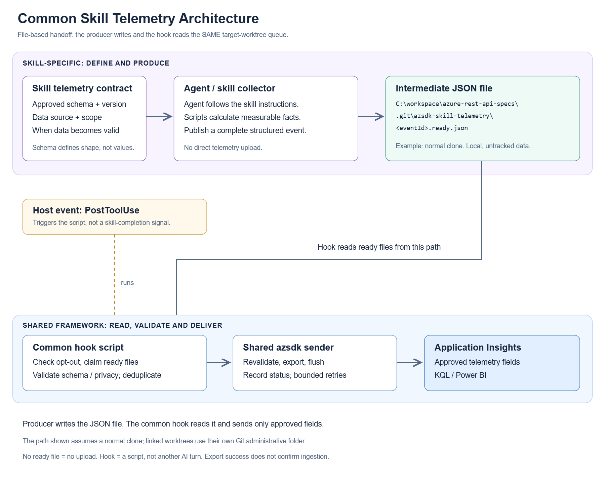

<!-- cspell:words azsdk AZSDKTOOLS contoso nonempty nonproduction reentrancy reparse revalidate revalidation typespec worktree worktrees -->

# Spec: 8-Operations - Common Skill Telemetry

**Status:** Proposed design specification (subject to privacy, host compatibility, and schema governance approval before rollout).

## Table of Contents

- [Definitions](#definitions)
- [Background / Problem Statement](#background--problem-statement)
- [Goals and Exceptions/Limitations](#goals-and-exceptionslimitations)
- [Design Proposal](#design-proposal)
- [TypeSpec Consumers](#typespec-consumers)
- [Alternatives Considered](#alternatives-considered)
- [Open Questions](#open-questions)
- [Success Criteria](#success-criteria)
- [Agent Prompts](#agent-prompts)
- [CLI Commands](#cli-commands)
- [Implementation Plan](#implementation-plan)
- [Testing Strategy](#testing-strategy)
- [Metrics/Telemetry](#metricstelemetry)
- [Documentation Updates](#documentation-updates)
- [References](#references)

## Definitions

| Term | Meaning |
|---|---|
| Producer | An agent following skill instructions, or a deterministic script, that creates a structured local event. |
| Production contract | The declared source, scope, validity checks, and exact point at which a skill may produce an event. A JSON schema alone is not this contract. |
| Invocation | One execution attempt with an opaque random ID; reading a skill file is not proof of execution. |
| Common hook | A deterministic script registered for a supported host's `PostToolUse` event. It does not invoke another model reasoning turn. |
| Ready event | An immutable, complete per-event JSON file atomically published for validation and export. |
| Exported | The shared exporter reported a successful flush. This is not a per-event backend ingestion acknowledgment. |

## Background / Problem Statement

Skills need reusable telemetry infrastructure without each skill implementing upload, privacy filtering, retries, and host integration. Some skills are pure prompt instructions; others already produce validated artifacts through scripts. The design must support both, across SDK languages and management-plane/data-plane workflows.

[Azure/azure-sdk-tools#17228](https://github.com/Azure/azure-sdk-tools/issues/17228) is a concrete consumer: collect TypeSpec authoring file changes and assessment dimension counts, identify the invocation surface, and enable specification-path reporting without collecting prompts. Repository-relative paths can correlate usage with later specification PRs; they do not prove that a skill caused a particular PR.

Companion proposal [Azure/azure-sdk-tools#16828](https://github.com/Azure/azure-sdk-tools/pull/16828) covers general SDK Agent operational telemetry: stateless lifecycle hook observation for tool/skill calls, first-use user disclosure across hosts, and selecting Application Insights as the initial data store. Raw hook payloads do not need a local disk queue for those stateless invocation counts, but they also cannot observe multi-step edit windows or validated domain artifacts produced inside a skill. This specification complements [#16828](https://github.com/Azure/azure-sdk-tools/pull/16828) by defining how skills produce structured, privacy-reviewed outcome events locally and hand them off to a common `PostToolUse` hook and the same shared `azsdk` Application Insights pipeline and consent model.

### Current State

| Existing component | Observed behavior and implication |
|---|---|
| [`eng/common/scripts/azsdk_tool_telemetry.ps1`](https://github.com/Azure/azure-sdk-tools/blob/main/eng/common/scripts/azsdk_tool_telemetry.ps1) | Detects the `skill` tool and reads of `skills/.../SKILL.md`, then starts `ingest-telemetry`. This is a load/invocation signal, not verified task completion. Its client inference defaults non-VS-Code cases to `copilot-cli`; it does not establish a verified `copilot-app` surface. |
| [`TelemetryIngestionTool.cs`](https://github.com/Azure/azure-sdk-tools/blob/main/tools/azsdk-cli/Azure.Sdk.Tools.Cli/Tools/Core/TelemetryIngestionTool.cs) | Accepts client, event type, session, skill, and prompt body. Custom event names are accepted, but there is no typed skill-specific payload ingestion or schema registry. |
| [`azsdk_prompt_telemetry.ps1`](https://github.com/Azure/azure-sdk-tools/blob/main/eng/common/scripts/azsdk_prompt_telemetry.ps1) | Forwards prompt bodies to `ingest-telemetry --body`; the ingestion tool performs prompt analysis. This is a separate collection path, not addressed merely by omitting prompts from new JSON. |
| [`MCPToolBase.cs`](https://github.com/Azure/azure-sdk-tools/blob/main/tools/azsdk-cli/Azure.Sdk.Tools.Cli/Tools/Core/MCPToolBase.cs) and telemetry services | CLI execution creates a `CommandExecuted` wrapper with command arguments and serialized response. Shared tags include device metadata; string path sanitization is not a general sensitive-data allowlist. |
| [`TelemetryRegistration.cs`](https://github.com/Azure/azure-sdk-tools/blob/main/tools/azsdk-cli/Azure.Sdk.Tools.Cli/Telemetry/TelemetryRegistration.cs) | Compile-time `DEBUG` selects the test Application Insights resource; Release selects production. Runtime `--debug` enables diagnostic output, not destination switching. |

The inspected `Azure/azure-rest-api-specs` checkout registers `PostToolUse` and `UserPromptSubmit` in `.github/hooks/hooks.json`. Registration in a repository is not proof that every host/version supports or enables those hooks.

[Azure/azure-sdk-tools#13878](https://github.com/Azure/azure-sdk-tools/pull/13878) is a **closed, unmerged documentation draft**, not implemented functionality. It proposed appended `.azsdk-agent-activity.log` text blocks, periodic CLI ingestion, and an optional VS Code watcher. Reuse its local handoff idea, but replace free-form blocks with independently validated JSON events and a common hook. Do not reuse its request-summary collection or treat its sample commands as available.

## Goals and Exceptions/Limitations

### Goals

- Provide one common collection contract and transport path for all participating skills.
- Permit skill-specific deterministic collectors and pure-prompt producers without requiring a skill runner.
- Separate business execution, local event production, validation, and export.
- Keep schemas, destinations, privacy policy, and delivery diagnostics centrally governed.
- Make missing evidence, unsupported hosts, and delivery failures distinguishable from success.
- Support the TypeSpec requirements as consumers, without embedding TypeSpec rules in the common transport.

### Non-Goals and Limitations

- No prompts, prompt summaries, source content, arbitrary free text, credentials, or raw tool arguments in this telemetry path.
- No complete measurement of all user activity, automatic PR linkage, or automatic authoring-to-assessment integration.
- No guaranteed execution of prompt instructions, universal skill-scoped post hooks, or assumed `SkillCompleted` host event.
- No exactly-once delivery, guaranteed delivery without an available hook, hidden indefinite daemon, or required VS Code extension.
- No new telemetry feedback UI. Hooks run scripts; they do not automatically provide a dashboard or skill completion UI.
- No security sandbox: centralizing the approved sender does not stop arbitrary skill scripts from uploading data independently. Code review, repository trust, permissions, and applicable network controls remain necessary.

## Design Proposal

### Architecture and Responsibilities



| Component | Responsibility |
|---|---|
| Skill owner | Declare a versioned privacy-approved schema and production contract; identify evidence and when collection begins/ends. |
| Producer | Respect opt-out before collecting telemetry, obtain invocation context, compute or extract allowed metrics, and publish complete events. No direct upload. |
| Host adapter | Register the hook for a tested host/version, supply verified host context, and handle its input/output and timeout contract. |
| Common hook | Inspect a bounded ready queue, enforce containment, claim files, validate against approved contracts, and invoke the shared sender. |
| Shared CLI sender | Revalidate at the transport boundary, map allowed fields to telemetry tags, enforce opt-out and centrally configured destination, flush, and return bounded delivery status. |
| Telemetry owners | Review schemas/validators, retention and metadata; maintain query contracts and dashboard mapping. |

Skills do not need an owning runtime. Trusted, enabled repository hooks execute where the host supports them. Installation and host/version registration are explicit prerequisites, not properties supplied by `SKILL.md`.

### 1. Skill Contract and Schema Registry

Each participating skill declares:

| Contract element | Required definition |
|---|---|
| Identity | Skill name/version, event names, schema IDs and versions, and schema owner. |
| Source | Which validated artifact or deterministic measurement supplies each field; distinguish model-authored values. |
| Scope | Selected repository-relative specification/package/files, invocation window, and concurrency rules. |
| Validity | Required fields, enums, count/range invariants, evidence availability, and incomplete-result behavior. |
| Production boundary | Exactly when the event becomes valid, how begin/context is established, and which failure/partial states may be reported. |
| Privacy and bounds | Approved path policy, field allowlist, maximum lengths/counts/bytes, retention, and any approved hashing/redaction. |

Proposed ownership layout: each participating skill owns `telemetry/result.schema.json` beside its `SKILL.md`, covering both common fields and the skill-specific `data` object. Optional deterministic collectors live under the skill's `scripts` directory, while reusable validation and atomic queue publication helpers live in `eng/common/scripts/skill-telemetry`. Exact file paths may evolve during implementation provided this ownership split between skill-owned collection contracts and centrally governed transport is preserved.

The installed registry pins approved schemas and code-reviewed semantic validators. A producer-supplied schema, schema URL, or field name cannot authorize sensitive collection. Unknown schemas/versions and additional properties are rejected, not forwarded as an arbitrary property bag. Changes require review and compatibility/version decisions.

For pure-prompt skills, a short instruction can write invocation context before work and a small schema-constrained event afterward. A script may instead collect the event. Prefer deterministic collection for measurable facts; schema-valid model output can still contain incorrect counts.

### 2. Common Envelope

The following is an **illustrative proposed wire format**, not existing CLI syntax or skill frontmatter:

```json
{
  "eventId": "38498015-0233-48a5-b672-14d6b3f94174",
  "invocationId": "4fd2c4ac-6c77-4639-a89a-ecb7ecae8320",
  "skill": {
    "name": "azure-typespec-assessment",
    "version": "0.0.0-beta"
  },
  "eventName": "skill.result",
  "schemaId": "azure-typespec-assessment.result",
  "schemaVersion": 1,
  "occurredAtUtc": "2026-11-02T07:00:00Z",
  "hostContext": {
    "invocationSurface": "copilot-app",
    "verification": "host-adapter"
  },
  "data": {
    "specificationPath": "specification/contoso/resource-manager/Microsoft.Contoso",
    "mode": "fast",
    "status": "succeeded",
    "dimensions": {
      "semantic": { "status": "skipped", "findingCount": null },
      "rest": { "status": "passed", "findingCount": 0 },
      "downstream": { "status": "failed", "findingCount": 1 },
      "azureGuidelines": { "status": "skipped", "findingCount": null },
      "documentQuality": { "status": "passed", "findingCount": 0 }
    }
  }
}
```

`schemaId` and `schemaVersion` identify the schema for the entire event, including common fields and skill-specific `data`. There is no separate envelope version. A breaking change to common fields requires a new version of each affected event schema.

Here `status: succeeded` means the declared result-production boundary succeeded, not that the assessed API is compatible or that the report was served to the user.

Use compact common event names: optional `skill.started`, `skill.result`, and bounded `skill.detail`. The result's typed status conveys succeeded, partial, failed, or cancelled execution; events are emitted only when the producer has evidence. No write means missing data, not a successful run. Keep legacy inferred load signals separate from these explicit events; do not sum them as equivalent invocations.

`invocationId` is shared by events for one attempt; `eventId` identifies one immutable event and is reused unchanged for every retry. A distinct event needs a distinct ID. IDs must be random opaque values, never absolute paths, usernames, or encoded host identifiers.

`occurredAtUtc` must parse as UTC and satisfy an approved clock-skew/age policy. The sender records its own observation time. Host context is enriched or verified by the adapter, not trusted because the agent wrote it. Supported surfaces are `vscode`, `copilot-cli`, and `copilot-app`; unresolved context is explicitly `unknown`, not guessed from a missing field or UI branding. Queue ownership preserves the originating context so a later hook does not relabel old events with its own surface. Host-context persistence is local metadata, not permission to export raw host session IDs.

### 3. Atomic Local Queue

Use an untracked per-worktree/workspace queue under an approved local location so the producer writes and the hook sweeps the same queue. The adapter or shared helper supplies the queue root; producers cannot select an upload endpoint or an arbitrary queue directory.

- **Default candidate — Git administrative directory** (as illustrated in the architecture diagram): `<git-dir>/azsdk-skill-telemetry/` resolved via `git rev-parse --git-dir` (`<repo>/.git/azsdk-skill-telemetry/<eventId>.ready.json` in a normal clone, or the worktree's own Git administrative folder in a linked worktree). This naturally isolates per-worktree state outside tracked files without separate workspace-ID mapping.
- **Alternative — Private OS application-data directory**: `<local-app-data>/azsdk-skill-telemetry/<opaque-workspace-id>/<opaque-session-id>/`, which also works outside Git checkouts and keeps state completely outside repository administration directories.

Within the selected queue directory, the proposed file lifecycle layout is:

```text
<queue-dir>/
    <eventId>.writing
    <eventId>.ready.json
    <eventId>.processing
    delivery-status.json
```

The event filename uses `eventId`, not `invocationId`, because one invocation can emit many events.

1. Check `AZSDKTOOLS_COLLECT_TELEMETRY` and applicable host consent before collecting telemetry-specific context, snapshots, or event files.
2. Write a uniquely owned temporary file, close it, then atomically rename within the same filesystem to `.ready.json`. Never append to an already-ready event.
3. Use a deterministic publish helper where available. A host's atomic write tool may be used if verified; otherwise an explicit rename step is required. An interrupted write stays unready and is eventually expired.
4. A hook inspects only complete ready files. It atomically claims each event before reading/exporting it; concurrent hooks must not both own it.

Validate canonical containment and ownership for the workspace/session/event; reject traversal, symlinks, junctions/reparse points, unexpected links, mismatched IDs, and files outside the approved queue root. Open/claim operations must preserve these checks against path replacement races. Do not discover files by unrestricted repository search or follow producer-provided arbitrary paths.

Bound individual event size, event count, scan time, total queue bytes, retry count, and TTL. Initial proposed ceilings are 32 KiB per ready event, 100 events or 2 seconds of discovery per hook, 10 MiB per session queue, 24-hour event TTL, and 3 export attempts. These are reviewable implementation defaults, not existing limits; tighten the event limit if serialized tags/exporter limits require it. Capacity/expiration produces a safe local reason code and an explicit gap, not silent truncation.

### 4. Hook Processing and Shared Export

The hook is a script, not an instruction asking the agent to analyze a tool result. It performs bounded deterministic work:

1. Check opt-out/consent before parsing payloads or invoking collection/sending.
2. Use trusted adapter context and sweep the owned ready queue. Do not require the triggering tool's arguments to contain an event path.
3. Claim ready files atomically, validate envelope/schema/semantic invariants, and normalize only approved fields. Reject forbidden content rather than attempting to make arbitrary text safe.
4. Check the bounded local event-ID ledger; reject a reused ID with different content. Send allowed fields through one shared CLI transport entry point.
5. Record a bounded result and acknowledge/remove exported queue entries; retain retryable entries until the next eligible hook subject to limits.

Sweeping matters because files may be written through shell tools, not only file-edit tools. Each host adapter must verify that a post-tool hook observes the atomic publication, or explicitly invoke a bounded drain after publication. Unsupported/disabled hooks mean no guaranteed delivery; a subsequent supported hook can drain a bounded backlog. No daemon is started to make this guarantee appear stronger.

Sender commands and telemetry housekeeping must be excluded from collection-trigger inference and must not generate new skill events. Use an internal reentrancy guard plus event claiming to prevent recursive hooks or nested sender calls from producing duplicate emissions. Merely ignoring all shell/edit tools is insufficient: those tools may publish ready events.

Proposed CLI transport extension: extend `ingest-telemetry` with `--event-file`, revalidate the event against the pinned schema registry inside the CLI, redact the event-file argument from `CommandExecuted`, and map the approved event into telemetry tags. Do not encode JSON in the existing prompt `--body` option. Revalidation in the sender protects against callers that bypass the hook. The common sender owns destination configuration, compatibility, batching, and exporter mapping, and preserves the producer `eventId` as the logical deduplication key instead of allowing the automatically generated activity ID tag to replace it.

### 5. Failure and Delivery Semantics

Telemetry must not fail the user's authoring, assessment, or other business operation. Hook stdout follows the host's required protocol; diagnostics go to bounded local status or the appropriate diagnostic stream. Use safe codes such as `invalid_schema`, `source_unavailable`, `queue_full`, `export_timeout`, and `unsupported_host`, without raw exceptions, payloads, arguments, or sensitive paths.

| Condition | Required behavior |
|---|---|
| Invalid or forbidden event | Do not upload. Record a safe local failure; discard payload or retain only in a tightly bounded approved local quarantine. |
| Sender unavailable, network failure, timeout | Leave a retryable record with bounded backoff/attempt metadata; retry only on a later eligible drain. |
| Hook/sender crash after export, before acknowledgment | Recover an expired processing lease and retry with the same event ID; duplicates are possible. |
| TTL, retry, or storage budget exhausted | Drop the payload and record a bounded local gap/failure counter. |
| Opted out | Do not collect, read event bodies, or send. Remove pending telemetry payloads and telemetry-only baselines using containment-safe cleanup; retain at most a payload-free disabled status. Do not replay old events on re-enable. |

Apply the stricter of host consent (aligned with the host approval model in [Azure/azure-sdk-tools#16828](https://github.com/Azure/azure-sdk-tools/pull/16828)) and CLI policy at collection and export. Preserve the current unset-enabled behavior only where consent policy permits; `AZSDKTOOLS_COLLECT_TELEMETRY=false` disables both. Invalid configuration must not enable collection accidentally.

Local statuses are `pending`, `exported`, `failed`, and `disabled`. They describe the delivery pipeline, not the skill's business result or confirmed ingestion. Successful exporter flush is not exactly-once backend acknowledgment; bounded retries permit at-least-once attempts and possible loss after export. Application Insights is eventually consistent. Queries collapse duplicates by logical `eventId`; repeated IDs with conflicting payloads are integrity errors.

### 6. Privacy Across the Entire Emission Path

The new envelope alone cannot establish the no-prompt requirement. Before enabling this flow:

- Remove or disable the `UserPromptSubmit` prompt collector for participating deployments, including downstream hook registrations. Audit existing prompt analysis ingestion so this flow never invokes it.
- Audit `CommandExecuted`, response serialization, activity tags, resource tags, exception/status descriptions, logs, and debug output. Do not serialize event bodies, queue paths, raw tool arguments, or prompts into wrapper telemetry.
- Review existing device/MAC-derived tags and raw session identifiers. Retain only explicitly approved metadata; suppress or replace these tags for this flow if they are outside the approved contract.
- Resolve repository-relative paths locally, normalize separators for the wire format, reject absolute/parent-traversing paths, and apply the reviewed path allowlist/redaction policy. Relative paths can still reveal sensitive service names; hashing is a reviewed trade-off with correlation requirements, not automatic anonymization.
- Keep raw baselines and assessment artifacts local. Never upload source lines, model rationale, free-text findings, fetched guidance, or file contents.

An allowlist at the export boundary is required; the current general string path sanitizer is not sufficient. Opt-out must also cover telemetry initialization and wrappers, not only a hook's happy path. Producer-owned schema declarations cannot bypass this policy.

### Cross-Language and Host Portability

The envelope, queue protocol, and sender are language-neutral. .NET, Python, Java, JavaScript/TypeScript, Go, and PowerShell collectors may produce the same contract; they need not share an implementation language. Reuse the shipped CLI and scripts where possible rather than introducing a runtime per skill.

Maintain a tested host/version matrix for hook registration, tool-write visibility, trusted surface attribution, timeouts, opt-out, and operating-system atomic file behavior. VS Code, Copilot CLI, and Copilot app support must be verified separately. A common hook can share policy while adapters retain host-specific differences; an unverified adapter is not advertised as supported.

## TypeSpec Consumers

TypeSpec skill definitions in `Azure/azure-rest-api-specs` are the source of truth for these integrations; the SDK Tools skill copy is downstream. Implement shared transport in SDK Tools, then update the source skill contracts and synchronize downstream copies through the established process.

### Authoring: Measure a Declared Edit Window

`azure-typespec-author` currently uses a prompt-driven workflow. It needs a small explicit begin/context step before edits and a finalize step after its declared validation/output boundary. A common collector can calculate file-change metrics; each skill need not implement a custom post hook.

The begin step establishes the invocation ID, selected specification and allowed files, baseline identity, and collection window. Capture the actual local pre-edit state, including pre-existing staged/unstaged changes and relevant untracked files. **Do not use `HEAD` as a proxy for the invocation baseline.** A completion-only hook cannot reconstruct an earlier working tree.

The collector compares that snapshot with the final local state using declared text/newline normalization and deterministic hunk accounting. Include created/deleted files and rename handling; record approved old/new relative paths for a rename rather than losing its identity. Do not modify the index or count already-staged changes again. Bound snapshots, exclude binaries/generated/out-of-scope files according to the contract, and mark unavailable or oversized evidence as incomplete rather than zero.

Serialize overlapping telemetry measurement windows for the same scope, or mark them overlapping/partial. External edits can occur even with a collector lock: measured net changes within the window are **not exclusive attribution to the skill**. A file edited and restored within the window has zero net change; this is not an edit-action counter.

The proposed result includes `updatedFiles` with `path`, `changeType`, `addedLineCount`, `deletedLineCount`, and `changedRanges`, plus totals. Supported change types are `modified`, `created`, `deleted`, and `renamed`; renames also include `previousPath`. Collect only approved repository-relative TypeSpec paths.

Clarify the issue's ambiguous range example by giving every hunk separate old/new coordinates:

```json
{
  "path": "specification/contoso/resource-manager/Microsoft.Contoso/main.tsp",
  "changeType": "modified",
  "addedLineCount": 12,
  "deletedLineCount": 3,
  "changedRanges": [
    {
      "old": { "startLine": 42, "lineCount": 3 },
      "new": { "startLine": 42, "lineCount": 12 }
    }
  ]
}
```

Coordinates follow the declared diff hunk convention, with 1-based nonempty ranges and a zero-length side for insertion/deletion; the empty side's start denotes the diff anchor and may be zero at file start. These are changed-line ranges without context. Whole-file creation has an empty old side; whole-file deletion has an empty new side. Final-newline-only changes need an explicit metadata flag under the reviewed schema rather than an invented added/deleted line.

For large results, split file/range details into bounded `skill.detail` events. A `skill.result` summary declares detail count and totals; details carry a result-group ID, ordinal, and expected part count. Collectors validate totals before publication; queries must not present incomplete detail groups as complete. Never silently truncate arrays or reduce totals to fit exporter limits.

### Assessment: Extract Validated Structured Results

`azure-typespec-assessment` already has a guarded finalizer and structured `assessment.json`. Add the collector at the point where finalization validates and publishes that artifact. Extract counts deterministically from the supported assessment artifact version, never from a model's prose or guessed totals.

The production contract includes specification-relative path, full/fast mode, artifact version, result-production status, and five dimension records: `semantic`, `rest`, `downstream`, `azureGuidelines`, and `documentQuality`. Normalize existing artifact states into documented telemetry states without implying more coverage than the source.

- Full mode reports all five dimensions according to validated coverage.
- Fast mode reports Semantic intents and Azure Guidelines as skipped, with null counts, even if semantic evidence ran internally.
- Not-assessed/unknown, skipped, and not-applicable states are distinct from assessed zero. A count of zero is valid only for a dimension actually assessed with no corresponding items.
- Semantic intents are descriptions of change, not defects. Clarify `semantic.findingCount` from the issue as an intent-item count for compatibility, or introduce a reviewed `intentCount` field in a new schema. Do not chart semantic items as defects. The schema must define whether informational intents are included.
- REST/downstream counts come from confirmed final findings, not raw candidates. Guideline and documentation counts follow the artifact's independently validated coverage and finding rules.

Artifact finalization is not the skill's full user-facing completion: the current skill additionally requires serving/linking the rendered report. This event measures the declared **result-produced** boundary; it must not claim the report was served. A future separate event would need evidence for that boundary.

If finalization fails or the artifact version is unsupported, emit only an allowed failed/partial status with unknown counts, if evidence exists; never a successful result populated with zeros. Keep assessment standalone and opt-in; this telemetry design does not invoke it automatically from authoring.

## Alternatives Considered

### Alternative: Each Skill Owns a Custom Post-Hook Script and Direct Emission

Each skill supplies its own script to collect facts after applicable tool activity and directly emit telemetry. Repository/host configuration registers or dispatches these scripts; a universal skill-local post-hook facility must not be assumed. The scripts may reuse shared libraries, but each skill owns its emission integration.

| Area | Primary: intermediate events + common hook/sender | Alternative: per-skill post-hook + direct emission |
|---|---|---|
| Flexibility | Supports pure-prompt producers and custom collectors; bounded schemas limit what can be exported. A new measurement may need registry changes. | Maximum control over timing, evidence collection, event shape, and delivery; useful for a specialized scripted skill. More scripts can require extra runtimes. |
| Governance/privacy | One reviewed export boundary and destination policy; schema review is reusable. Still not a sandbox against unrelated uploads. | Each emitter needs equivalent privacy, opt-out, destination, wrapper, and dependency review. Easy for policies to drift unless rigorously enforced. |
| Reliability | Atomic queue, shared retries/claiming/deduplication, and recoverable handoff. Adds file lifecycle and crash-recovery complexity; a missing producer write is still invisible. | A script can couple deterministic collection closely to its own finalizer and avoid queue overhead. Direct sends face hook timeout/network failures unless each implements buffering and recovery. |
| Portability | Shared protocol across hosts/languages, with adapter work per host/version. No guaranteed delivery on an unsupported host. | Skill can optimize for one host; every script still needs supported registration/dispatch and cross-host testing. No automatic skill-scoped lifecycle. |
| Implementation cost | Higher initial registry/queue/transport investment; low marginal cost per additional skill. Common failures have broader impact. | Lower initial cost for one scripted skill; repeated lifecycle, testing, exporter, and maintenance work as adoption grows. |
| Observability/UI | Uniform local pending/exported/failed/disabled status and query contract; can support a future UI. No automatic UI today. | Can tailor local diagnostics or a future skill UI; visibility and delivery statuses are otherwise fragmented. A hook alone provides no UI. |
| Measurement accuracy | Deterministic collectors can share measurement helpers; validity depends on evidence and production contracts, not only validation. | Skill-specific scripts can provide equally accurate metrics with proper evidence; custom emission itself does not improve attribution or model judgment. |

**Recommendation:** Use intermediate events with the common hook and sender as the default for all participating skills. Keep custom **collection** in the skill where needed, while centralizing transport/export. The alternative is reasonable for an isolated scripted consumer with a justified lifecycle need, but requires the same privacy approval and an explicit ownership exception; it should not become an unreviewed parallel telemetry channel.

The earlier appended text-log/periodic-ingestion proposal remains historical prior art, not a second implementation dependency. It is less suitable for per-event validation, concurrent ownership, and field-level privacy control; the optional VS Code watcher also adds editor-specific deployment.

## Open Questions

1. Which host/version adapters can provide verified `copilot-app` attribution and reliable post-publication hooks? Publish the compatibility matrix before rollout.
2. Should the default local queue root live under the Git admin directory (`<git-dir>/azsdk-skill-telemetry/`) for natural worktree locality, or under private OS application data so non-Git workspaces share one path convention?
3. Which specification path forms are privacy-approved, and can correlation use reviewed redaction/hashing while meeting the issue's reporting requirement?
4. Should `semantic.findingCount` retain its name with explicit intent semantics or become `intentCount`? Which informational intents belong in the metric?
5. Who approves registry entries and shared metadata, and owns downstream dashboard/query migration? Confirm queue/export budgets against actual exporter limits during implementation.

These are rollout/contract approvals, not assumptions that existing hooks or schemas already solve them.

## Success Criteria

- A pure-prompt skill and a scripted skill can use the same approved queue/sender contract without a mandatory runner or per-skill uploader.
- TypeSpec authoring reports the selected scope's validated net changes from an explicit pre-edit baseline, including dirty/untracked/create/delete/rename cases and unambiguous old/new ranges.
- Assessment reports validated five-dimension metrics with full/fast coverage, preserving unknown/skipped/not-applicable states and distinguishing intent from defects.
- Concurrent hooks cannot own the same event simultaneously; crash retries preserve event IDs; reporting collapses duplicates and detects incomplete detail groups.
- Opt-out prevents collection and upload, removes queued telemetry without replay, and passes end-to-end privacy checks including legacy prompt hooks and wrappers.
- Unsupported hosts, absent events, queue limits, and exporter failures do not block business work or masquerade as success.
- The TypeSpec dashboard can display approved specification-path and verified surface fields, with documented ingestion delay and metric semantics. This is a downstream reporting deliverable, not UI automatically created by hooks.

## Agent Prompts

Telemetry does not require the user to request logging. It follows approved skill instructions and consent settings.

| User request | Expected agent/producer behavior |
|---|---|
| "Add a preview API version to this TypeSpec specification." | Invoke authoring normally; if enabled, establish scoped telemetry context before edits, run its normal validation, then use the collector to publish measured results. Do not invoke assessment automatically. |
| "Assess these TypeSpec changes in fast mode." | Follow the assessment's baseline confirmation and normal workflow; after guarded artifact finalization, collect typed metrics with explicit skipped dimensions. Serving/linking the report remains a separate required business step. |

## CLI Commands

**Existing invocation ingestion**, shown only to establish the current interface:

```text
azsdk ingest-telemetry --client-type vscode --event-type skill_invocation --skill-name azure-typespec-author
```

This command does not ingest the proposed typed payload. The `--body` option is for the existing prompt-analysis path and must not be repurposed for these events.

**Proposed internal integration surfaces:** the authoring collector supports `begin` and `complete` steps; assessment finalization invokes its collector directly; the `PostToolUse` script drains ready events through `azsdk ingest-telemetry --client-type <verified-surface> --event-file <claimed-file>`. These are internal integration surfaces rather than a user-facing CLI contract. There is no producer endpoint override, and the event-file path is redacted from command-wrapper telemetry. Do not introduce the activity-log command shown in the unmerged [#13878](https://github.com/Azure/azure-sdk-tools/pull/13878) draft as though it exists.

## Implementation Plan

1. **Approve contract and privacy boundary.** Define the common envelope, schema registry/validators, production contracts, metadata policy, queue root and budgets, and host support matrix. Audit/remove participating prompt-collection registrations and close wrapper metadata leaks before enabling new collection.
2. **Build shared infrastructure.** Add atomic publish/claim helpers, bounded queue cleanup/status, typed CLI ingestion (`--event-file`), logical event-ID preservation, sender revalidation, and guarded hook adapters. Prove behavior using a nonproduction build and synthetic data.
3. **Adopt TypeSpec consumers.** Update the source skills in `Azure/azure-rest-api-specs`: authoring begin/snapshot/finalize collection and assessment artifact extraction. Review metric semantics, then synchronize downstream skill copies.
4. **Roll out and report.** Enable only reviewed hosts/contracts, map approved tags into existing queries/dashboard, verify duplicate collapse and incomplete coverage, and document operational ownership. Expand to other skills using the same contracts.

## Testing Strategy

This document proposes future implementation verification; it does not require sending telemetry while writing the specification.

| Layer | Required checks |
|---|---|
| Schema and privacy | Unknown versions/properties, wrong types, invalid UTC/enums/counts/ranges, oversized data, forbidden paths/text, untrusted host context, and producer endpoint attempts are rejected. Inspect wrappers, logs, debug output, and automatic tags as well as payloads. |
| Queue and hooks | Partial writes never export; concurrent claims, crashes before/after flush, stale leases, repeated IDs with changed content, sender recursion, shell publication, timeout/TTL/budget limits, and containment/link races behave as specified. |
| Consent | Disabled collection creates no telemetry-specific snapshots/events; queued data is purged without parsing/upload, no replay occurs, and legacy prompt registrations cannot leak prompts. |
| Authoring | Pre-existing dirty, staged/unstaged, untracked, created/deleted/renamed, overlapping/external changes, empty files, CRLF/LF, and final-newline-only edits produce declared net metrics or explicit incomplete states. Summary totals match all detail parts. |
| Assessment | Validated full/fast fixtures, unsupported artifacts, failed finalization, semantic informational-item rules, and not-applicable documentation coverage preserve source semantics; an unserved report is never reported as UI completion. |
| Host/OS integration | Test supported host versions on Windows/Linux/macOS as applicable for atomic publication, hook trust/enablement, verified surfaces, opt-out, bounded completion, and unavailable-hook backlog. |
| End-to-end reporting | Synthetic nonproduction events appear eventually with allowlisted fields, stable logical IDs, duplicate collapse, complete detail grouping, and correct dashboard dimensions. Flush success alone is not the assertion. |

Use compile-time Debug builds for test-resource verification under the current routing implementation; runtime `--debug` is not a safe production-to-test switch. A Release routing override would be a separately reviewed change, not an existing feature or a prerequisite assumed by this proposal. Never put connection strings or real device/session identifiers in fixtures or documentation.

## Metrics/Telemetry

Use approved skill metrics plus bounded pipeline health counts: events published, rejected by safe reason code, exported, retried, expired, disabled, and dropped due to capacity. Avoid recursive telemetry about telemetry; local counters are sufficient initially. Missing producer events cannot be counted accurately without independent evidence, so do not equate observed starts or inferred loads with total real usage.

Queries group by approved skill/version, event/schema version, verified surface, and specification scope. Distinguish business result from delivery state; distinguish defects from semantic intent. Details are complete only when their declared group is complete. Application Insights currently receives these activities in `dependencies` with tags in `customDimensions`; do not assume `customEvents` without an explicit exporter/query migration.

Common status artifacts can support a future diagnostic UI. Dashboard enhancements required by the TypeSpec issue are separate reporting work; neither agent hooks nor local event files automatically create that UI.

## Documentation Updates

Implementation should document the schema/production-contract authoring guide, supported hook adapters and trust setup, consent and queue cleanup, safe troubleshooting, and dashboard metric semantics. Update source TypeSpec skill instructions and their downstream copies together. Document any newly shipped CLI interface only after its syntax and behavior exist.

## References

- [Azure/azure-sdk-tools#17228: TypeSpec skill telemetry requirements](https://github.com/Azure/azure-sdk-tools/issues/17228).
- [Azure/azure-sdk-tools#16828: companion SDK Agent telemetry approaches proposal](https://github.com/Azure/azure-sdk-tools/pull/16828).
- [Azure/azure-sdk-tools#13878: closed, unmerged telemetry collection draft](https://github.com/Azure/azure-sdk-tools/pull/13878).
- [Existing tool telemetry hook](https://github.com/Azure/azure-sdk-tools/blob/main/eng/common/scripts/azsdk_tool_telemetry.ps1) and [prompt telemetry hook](https://github.com/Azure/azure-sdk-tools/blob/main/eng/common/scripts/azsdk_prompt_telemetry.ps1).
- [Telemetry ingestion](https://github.com/Azure/azure-sdk-tools/blob/main/tools/azsdk-cli/Azure.Sdk.Tools.Cli/Tools/Core/TelemetryIngestionTool.cs), [command wrapper](https://github.com/Azure/azure-sdk-tools/blob/main/tools/azsdk-cli/Azure.Sdk.Tools.Cli/Tools/Core/MCPToolBase.cs), [service](https://github.com/Azure/azure-sdk-tools/blob/main/tools/azsdk-cli/Azure.Sdk.Tools.Cli/Telemetry/TelemetryService.cs), [registration/routing](https://github.com/Azure/azure-sdk-tools/blob/main/tools/azsdk-cli/Azure.Sdk.Tools.Cli/Telemetry/TelemetryRegistration.cs), and [tag processor](https://github.com/Azure/azure-sdk-tools/blob/main/tools/azsdk-cli/Azure.Sdk.Tools.Cli/Telemetry/TelemetryProcessor.cs).
- [Source TypeSpec authoring skill](https://github.com/Azure/azure-rest-api-specs/tree/main/.github/skills/azure-typespec-author), [source assessment skill](https://github.com/Azure/azure-rest-api-specs/tree/main/.github/skills/azure-typespec-assessment), and [source hook configuration](https://github.com/Azure/azure-rest-api-specs/blob/main/.github/hooks/hooks.json). Source links evolve; consumer implementations must pin compatible artifact/contract versions.
- [TypeSpec authoring design](https://github.com/Azure/azure-sdk-tools/blob/main/tools/azsdk-cli/docs/specs/typespec-authoring.spec.md) and [TypeSpec assessment design](https://github.com/Azure/azure-sdk-tools/blob/main/tools/azsdk-cli/docs/specs/typespec-assessment.spec.md).
