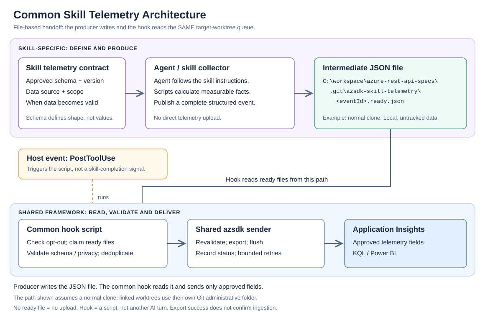

<!-- cspell:words azsdk AZSDKTOOLS contoso deduplicate deduplication revalidate typespec untracked worktree worktrees -->

# Spec: 8-Operations - Common Skill Telemetry

## Table of Contents

- [Existing Skill Telemetry and Gaps](#existing-skill-telemetry-and-gaps)
- [Design Proposal](#design-proposal)
- [What Skill Owners Do to Add Customized Telemetry](#what-skill-owners-do-to-add-customized-telemetry)
- [Alternatives Considered](#alternatives-considered)
- [Open Questions](#open-questions)

## Existing Skill Telemetry and Gaps

Today, [`azsdk_tool_telemetry.ps1`](https://github.com/Azure/azure-sdk-tools/blob/main/eng/common/scripts/azsdk_tool_telemetry.ps1) runs on `PostToolUse` and calls [`azsdk ingest-telemetry`](https://github.com/Azure/azure-sdk-tools/blob/main/tools/azsdk-cli/Azure.Sdk.Tools.Cli/Tools/Core/TelemetryIngestionTool.cs) whenever the agent invokes the `skill` tool or reads `/skills/<name>/SKILL.md`:

| Category | Already recorded automatically (zero skill-owner work) | Not supported today (gap) |
| --- | --- | --- |
| Skill invocation | `event_type = skill_invocation`, `skill_name`, and timestamp in Application Insights `dependencies` | Whether the skill finished, succeeded, or failed |
| Client & session info | `client_name` (`vscode` if `tool_use_id` contains `_vscode-`, otherwise `copilot-cli`), optional `session_id`, plus CLI `azsdk_tool_version`, `dev_device_id`, `mac_address_hash`, and `event_id` | Distinguishing `copilot-app` from `copilot-cli` (today both are recorded as `copilot-cli`) |
| Customized skill metrics | Separate MCP tool calls record their own tool-level telemetry | **Skill-specific customized telemetry** (e.g., [#17228](https://github.com/Azure/azure-sdk-tools/issues/17228): changed `.tsp` files and line ranges, finding counts, or workflow outcomes) without collecting user prompts |

Because Azure SDK has many pure-prompt and script-backed skills across languages and planes, this spec extends the existing hook and Application Insights pipeline so any skill needing **customized telemetry** can record validated structured fields—using `azure-typespec-author` throughout as the running example.

## Design Proposal

### Architecture



| Component | Owner | Responsibility |
| --- | --- | --- |
| Skill schema & collector | Skill owner | Define a JSON schema (`telemetry/result.schema.json`) and write a local `.ready.json` file when telemetry is enabled (no direct upload) |
| Local queue folder | Shared helper | Untracked per-worktree folder (`<git-dir>/azsdk-skill-telemetry/`) holding `<eventId>.ready.json` files |
| Common `PostToolUse` hook | Shared framework | Check opt-out, claim `.ready.json` files, validate schema and relative paths, and call `azsdk ingest-telemetry` |
| Shared `azsdk` sender | Shared framework | Revalidate schema, keep `eventId` for deduplication, and flush approved fields to Application Insights |

### 1. Event Format and Privacy

Each skill that needs customized telemetry defines a versioned JSON schema (`schemaId` + `schemaVersion`) for its `data` payload. Unknown schemas or unexpected fields are rejected.

Example `skill.result` file written by `azure-typespec-author`:

```json
{
  "eventId": "38498015-0233-48a5-b672-14d6b3f94174",
  "invocationId": "4fd2c4ac-6c77-4639-a89a-ecb7ecae8320",
  "skill": { "name": "azure-typespec-author", "version": "0.1.0" },
  "eventName": "skill.result",
  "schemaId": "azure-typespec-author.result",
  "schemaVersion": 1,
  "occurredAtUtc": "2026-11-02T07:00:00Z",
  "data": {
    "status": "succeeded",
    "updatedFiles": [
      {
        "path": "specification/contoso/resource-manager/Microsoft.Contoso/main.tsp",
        "changeType": "modified",
        "addedLineCount": 12,
        "deletedLineCount": 3,
        "changedRanges": [
          { "old": { "startLine": 42, "lineCount": 3 }, "new": { "startLine": 42, "lineCount": 12 } }
        ]
      }
    ],
    "totals": { "updatedFileCount": 1, "addedLineCount": 12, "deletedLineCount": 3 }
  }
}
```

- **IDs**: `invocationId` groups events from one skill run; `eventId` is a fixed UUID kept across retries so KQL queries can deduplicate.
- **Privacy rules**: Never collect user prompts, source code, free-text findings, or local absolute paths. Only allow repo-relative paths, respect `AZSDKTOOLS_COLLECT_TELEMETRY=false`, and do not log raw `--event-file` contents in CLI command telemetry.

### 2. Local Queue and Hook Delivery

1. **Write ready file**: When telemetry is enabled, the skill writes `<eventId>.writing` and renames it to `<git-dir>/azsdk-skill-telemetry/<eventId>.ready.json` (using `git rev-parse --git-dir`, e.g., `azure-rest-api-specs\.git\azsdk-skill-telemetry\`, so `git status` stays clean and worktrees stay isolated).
2. **Claim & validate**: On `PostToolUse`, the common hook checks opt-out, renames `.ready.json` to `.processing`, and drops oversized, expired, or invalid files.
3. **Send & fail-open**: The hook runs `azsdk ingest-telemetry --client-type <client> --event-file <file>`, which validates the schema and exports approved fields to Application Insights (`dependencies.customDimensions`). Failures never block user work; transient send errors retry within a small cap, and opting out deletes queued files.

## What Skill Owners Do to Add Customized Telemetry

- **If a skill only needs invocation counts**: **Do nothing.** The existing `PostToolUse` hook already records `skill_invocation` automatically.
- **If a skill needs customized telemetry**: Skill owners do **not** write hooks, retry logic, or Application Insights upload code. They only add three things in their skill:

| Step | What the skill owner does | Example: `azure-typespec-author` |
| --- | --- | --- |
| 1. Define JSON schema | Add `telemetry/result.schema.json` (`schemaId`, `schemaVersion`, and allowed `data` fields) | Defines `azure-typespec-author.result` v1 with repo-relative `.tsp` `updatedFiles`, line `changedRanges`, and `totals` |
| 2. Write `.ready.json` | Add a small collector script (preferred when reading local files/diffs) or JSON-write step that checks opt-out and writes `<eventId>.ready.json` | Script provides `begin` (records pre-edit git state before touching `.tsp` files) and `complete` (diffs final changes and writes `.ready.json`). *(Skills that only summarize final outputs skip `begin`.)* |
| 3. Call from `SKILL.md` | Add a step in `SKILL.md` (or existing script) to run the collector when the skill finishes | `SKILL.md` runs `begin` before editing TypeSpec files and `complete` right after TypeSpec validation |

Once `<eventId>.ready.json` is written, the shared `PostToolUse` hook and `azsdk` CLI automatically validate and send it to Application Insights.

## Alternatives Considered

| Area | Primary: local `.ready.json` queue + shared hook/sender | Alternative: custom post-hook per skill + direct send |
| --- | --- | --- |
| Skill support | Works for both pure-prompt skills and script-backed skills | Easy for scripted skills, awkward for pure-prompt skills |
| Privacy review | One shared validation and upload point in `azsdk` | Every skill script must implement its own opt-out and field checks |
| Reliability | Fast local file write; hook handles retries and deduplication | Network sends inside skill scripts can slow down or fail the skill |
| Skill-owner effort | Only define schema + write local `.ready.json` | Maintain hook scripts, client detection, and App Insights upload per skill |

**Recommendation:** Use the local `.ready.json` queue with the shared `PostToolUse` hook and `azsdk` sender, keeping only domain metric calculation inside each skill.

## Open Questions

- [ ] **Does telemetry have to go through MCP (`azsdk`)**: Should telemetry always be sent through the `azsdk` MCP CLI (`azsdk ingest-telemetry`), or can the shared hook script send directly to Application Insights (e.g., when a skill runs in an environment without the `azsdk` MCP server/CLI installed)?
- [ ] **How to detect `copilot-app`**: Today `azsdk_tool_telemetry.ps1` only checks whether `tool_use_id` contains `_vscode-` and labels everything else `copilot-cli`. What hook field or environment variable identifies `copilot-app`?
- [ ] **Where to store schemas across repos**: `azsdk` CLI lives in `azure-sdk-tools`, while some skills (like `azure-typespec-author`) live in `azure-rest-api-specs`. Should `azsdk` keep approved schemas in `azure-sdk-tools`, or read `telemetry/result.schema.json` from the skill folder?
- [ ] **Are repo-relative paths allowed in private repos**: Can repo-relative paths (e.g., `specification/contoso/.../main.tsp`) always be sent as plain text, or do private repos need path hashing before public release?

