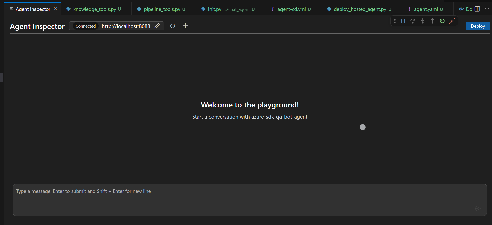

# Azure SDK Chat Agent

The Azure SDK Chat Agent helps developers with Azure SDK questions. It is built on the [Microsoft Agent Framework](https://learn.microsoft.com/agent-framework/overview/agent-framework-overview) with Azure AI Foundry. It leverages Azure AI Search for knowledge retrieval and Foundry Memory for conversation context.

> **Note:** This project is currently in draft / active development.

## Project Structure

```
azure-sdk-qa-bot-agent/
├── agents/          # Agent definition, instructions, and tool implementations
├── config/          # Configuration (Azure App Configuration integration)
├── services/        # Core business logic (chat, conversation, feedback)
├── utils/           # Azure service clients (AI Foundry, AI Search, Cosmos DB, Storage, Memory)
├── models/          # Data models
├── pipelines/       # CI/CD pipeline definitions
├── tests/           # Test files
├── server.py        # Backend API entrypoint (FastAPI)
└── TROUBLESHOOTING.md
```

The project has three independently runnable components:

| Component | Description | Entrypoint | Port |
|-----------|-------------|------------|------|
| **Chat Agent** | AI chat agent (Microsoft Agent Framework, Responses protocol) | `agents/chat_agent/init.py` | 8088 |
| **Chatbot Evolution Agent** | KB-quality analyst that diagnoses negative-feedback turns and files KB-gap GitHub issues | `agents/chatbot_evolution_agent/init.py` | 8088 |
| **Server** | Backend API that the Teams App communicates with (FastAPI) | `server.py` | 8089 |

> Both hosted agents bind port `8088`. Run **one at a time** locally.

## Getting Started

### Prerequisites

- Python 3.10 or higher
- Azure CLI installed and authenticated (`az login`)
- Azure subscription with access to:
  - Azure App Configuration
  - Azure AI Search
  - Azure Storage
  - Azure OpenAI / Azure AI Foundry
  - Microsoft Foundry Project

### Required Azure Roles

Ensure your Azure identity has:

- App Configuration Data Reader
- Storage Blob Data Contributor
- Azure AI User (on the Foundry Project)
- Cosmos DB Built-in Data Contributor

### Setup

1. Navigate to the project:

   ```bash
   cd tools/sdk-ai-bots/azure-sdk-qa-bot-agent
   ```

2. Create and activate a virtual environment:

   **Windows (PowerShell):**

   ```powershell
   python -m venv .venv
   .\.venv\Scripts\Activate.ps1
   ```

   **macOS/Linux:**

   ```bash
   python -m venv .venv
   source .venv/bin/activate
   ```

3. Install dependencies:

   ```bash
   pip install -r requirements-dev.txt
   ```

   This installs all production dependencies plus development tools (`debugpy`, `agent-dev-cli`). CI/CD pipelines and Docker images use `requirements.txt` (production only).

4. Create a `.env` file in the project root:

   ```dotenv
   AZURE_APPCONFIG_ENDPOINT=https://azuresdkqabot-dev-config.azconfig.io
   ```

   Optional variables:

   | Variable | Purpose | Default |
   |----------|---------|---------|
   | `GITHUB_TOKEN` | [GitHub PAT](https://github.com/settings/tokens) for local GitHub MCP tool testing. Without it, the agent uses GitHub App JWT via Key Vault (production only). | — |
   | `MEMORY_UPDATE_DELAY` | Seconds before processing memory updates. Set to `0` for immediate updates during development. | `300` |

5. Log in to Azure:

   ```bash
   az login  # select the Azure SDK Engineering System subscription
   ```

## Running and Debugging Locally

### Debugging the Chat Agent

Use this to develop and test the AI agent itself (prompt tuning, tool integration, etc.).

1. Install the [AI Toolkit](https://marketplace.visualstudio.com/items?itemName=ms-windows-ai-studio.windows-ai-studio) extension for VS Code.
2. Use this instruction to let your copilot set up local debugging with the AI Toolkit: `Help me configure the azure-sdk-qa-bot-agent/agents to work with AI Toolkit Agent Inspector. 1) Ensure the agent is serverized as an HTTP server. 2) Install 'agent-dev-cli' and use 'agentdev' to launch the agent. 3) Add VS Code configuration (tasks.json and launch.json) for debugging.`
3. Copilot will automatically generate the debug configuration (`.vscode/launch.json` and `.vscode/tasks.json`) for the project.
4. Press **F5** and select the agent to debug:
   - **Debug Chat Agent HTTP Server** launches `agents/chat_agent/init.py`.
   - **Debug Azure MCP Server Agent HTTP Server** launches `agents/azure_mcp_server_agent/init.py`.

This launches the agent via `agentdev run` on `http://localhost:8088/` with `debugpy` attached, and opens the AI Toolkit Agent Inspector for interactive testing.



### Debugging the Chatbot Evolution Agent

The Chatbot Evolution Agent is a hosted Foundry agent like the chat agent, but driven by the daily feedback-job scan (`scripts/run_feedback_jobs.py`), which runs it in-process via `services/chatbot_evolution_agent_service.py`, instead of by Teams. There are two things you may want to debug — the agent's reasoning, or the end-to-end scan→feedback flow.

**1. Iterate on the agent itself (Agent Inspector).**

Same AI Toolkit workflow as the chat agent, just pointed at the chatbot evolution agent entrypoint.

1. Install the [AI Toolkit](https://marketplace.visualstudio.com/items?itemName=ms-windows-ai-studio.windows-ai-studio) extension for VS Code.
2. Use this instruction to let your copilot set up local debugging with the AI Toolkit: `Help me configure the azure-sdk-qa-bot-agent/agents/chatbot_evolution_agent to work with AI Toolkit Agent Inspector. 1) Ensure the agent is serverized as an HTTP server. 2) Install 'agent-dev-cli' and use 'agentdev' to launch the agent. 3) Add VS Code configuration (tasks.json and launch.json) for debugging.`
3. Copilot will generate the debug configuration (`.vscode/launch.json` and `.vscode/tasks.json`) pointing at `agents/chatbot_evolution_agent/init.py`. If you already have the chat agent config, just swap the task command to:

   ```text
   ${command:python.interpreterPath} -m debugpy --listen 127.0.0.1:5679 -m agentdev run agents/chatbot_evolution_agent/init.py --verbose --port 8088
   ```

4. Press **F5** to start debugging, then use the Agent Inspector to send a JSON payload shaped like a `ChatbotEvolutionAgentInput`:

```json
{
  "mode": "analysis",
  "conversation_id": "<a real conversation id from Cosmos>",
  "conversation_type": "teams_channel",
  "evaluation_time": "2026-01-01T00:00:00+00:00",
}
```

The agent derives `tenant_id` from `fetch_conversation`, then calls `fetch_chat_trace` / `search_knowledge_base` and may file a real GitHub issue or ADO work item — use a throwaway conversation when iterating.

**2. Debug the feedback loop end-to-end.**

`ChatbotEvolutionAgentService` runs the hosted chatbot evolution agent synchronously against the *deployed* Foundry agent, using the chat agent's shared streaming response client with a 600-second job limit and no invocation-level retries. Its settings (`AI_FOUNDRY_CHATBOT_EVOLUTION_AGENT_NAME`, `AI_FOUNDRY_CHATBOT_EVOLUTION_AGENT_VERSION`, `CHATBOT_EVOLUTION_AGENT_ENABLED`, `AGENT_APPLICATIONINSIGHTS_RESOURCE_ID`) are read from Azure App Configuration and are already provisioned per environment — you do not need to set them locally.

The daily poller treats the global `ADO_ISSUE_CLOSED_STATE` App Configuration value as terminal, defaulting to `Closed`.

The scan refreshes ongoing thread metadata after human-only replies as well as bot replies. Before processing enabled Agent jobs, it recovers `created`/`running` feedback inactive for at least 20 minutes into retryable `failed` state; conditional writes prevent overwriting concurrent updates.

Ongoing threads without an active feedback workflow are automatically marked `finished`/`correct` after at least 144 hours since the latest conversation message, without invoking the Evolution Agent and regardless of user feedback. The scan verifies the actual transcript. Automatic closures are marked with `auto_closed_at`; a newer reply reopens them on ingestion and restarts the inactivity clock, including replies persisted while closure was in progress. Agent-assessed conclusions remain immutable to message ingestion. The recorded reasoning identifies automatic closure, and no confidence score is assigned. Negative feedback is still saved, but does not reopen automatically closed records; it can reopen Agent-assessed correct records. Dry runs and disabled Agent processing do not auto-close records.

To exercise the loop locally:

1. Run the daily scan against a small window: `python scripts/run_feedback_jobs.py --days 2` (ingests active threads and runs the hosted chatbot evolution agent in-process to analyze `ongoing` records and validate remediated failures). Use `--dry-run` to ingest records without invoking the agent. Set breakpoints in `services/chatbot_evolution_agent_service.py` to step through a run.
2. Inspect outcomes in:
   - **Script logs** — the service logs a bounded preview of the Agent's structured result.
   - **Cosmos `qa-records` container** — partitioned by `/tenant_id`; each thread row carries `qa_status` (`ongoing → finished | failed`) and an embedded `feedback.status` for Agent work (`created → running → pending_validation → done | failed`).
   - **Foundry tracing** — the hosted agent's tool calls are visible in the Foundry portal under the agent's run history.

### Debugging the Server

1. Add a launch configuration for the FastAPI server:

   ```json
   {
       "name": "Debug Backend Server",
       "type": "debugpy",
       "request": "launch",
       "module": "uvicorn",
       "args": ["server:app", "--host", "0.0.0.0", "--port", "8089"],
       "cwd": "${workspaceFolder}"
   }
   ```

2. Press **F5** to start debugging the server.
3. Install the [REST Client](https://marketplace.visualstudio.com/items?itemName=humao.rest-client) extension.
4. Run tests under `tests/api_test.rest` to verify the server is working.
5. Open `http://localhost:8089/dashboard/qa-records` to inspect QA and
   feedback lifecycle records. The dashboard supports tenant, status,
   updated-time, and conversation ID filters.

## Testing Remote Endpoints

The main endpoint for querying the bot is `/agent/chat`. See [tests/api_test.rest](https://github.com/Azure/azure-sdk-tools/blob/main/tools/sdk-ai-bots/azure-sdk-qa-bot-agent/tests/api_test.rest) for example requests.

### Remote Endpoints

| Environment | Resource Group | App Service Name |
|---|---|---|
| **Dev** | `azure-sdk-qa-bot-dev` | `azuresdkqabot-dev-server` |
| **Preview** | `azure-sdk-qa-bot-test` | `azuresdkqabot-test-server` |
| **Prod** | `azure-sdk-qa-bot` | `azuresdkqabot-server` |

To find the App Service in the Azure Portal:

1. Go to the [Azure Portal](https://portal.azure.com) and sign in with your Microsoft account.
2. Navigate to the **Azure SDK Engineering System** subscription.
3. Open the resource group for the target environment (see table above).
4. Select the App Service resource.
5. The endpoint URL is the **Default domain** field in the App Service overview.

### Access Tokens

```bash
# Dev
az account get-access-token --resource api://azure-sdk-qa-bot-dev

# Preview
az account get-access-token --resource api://azure-sdk-qa-bot-test

# Prod
az account get-access-token --resource api://azure-sdk-qa-bot
```

## Trying Teams images

The answering agent can use inline screenshots, diagrams, and uploaded image files as additional context alongside the user's text and retrieved knowledge.
The Graph-to-Activity converter preserves both HTML inline images and image-file entries in the message's `attachments` array, including SharePoint `reference` attachments represented by `<attachment id="...">` placeholders.
For autoreplies, the Logic App downloads Graph-hosted inline images using its existing Teams connector and replaces their attachment URLs with base64 data URIs.
The `Resolve image bytes` scope contains four guarded parallel download branches and waits for all branches before collecting captured bytes through direct action-output references instead of `result()` loop execution records, which can omit secured payloads.
Image-bearing actions keep their inputs or outputs hidden in run history; "Content not shown due to security configuration" is expected and does not indicate a download failure.
The TypeScript bot forwards those data URIs through the existing `additional_infos[].link` field, and the backend validates the image bytes before sending `input_image` content to the hosted agent.
The backend does not need Graph permission when the Teams connector supplies the bytes.
SharePoint files and URLs received without connector-provided bytes still use the backend downloader and its own permissions.

Prerequisites:

- The deployment selected by `AI_FOUNDRY_AGENT_COMPLETION_MODEL` must support image input through the hosted agent.
- The Logic App's Teams connection must be authorized to read hosted content in the monitored channels; the connector performs a Graph `GET` on the image's `/$value` endpoint.
- If sending Graph URLs directly to the backend instead, its identity needs channel-message read access: `ChannelMessage.Read.All` application permission with admin consent, or an appropriately configured Teams app identity with `ChannelMessage.Read.Group` resource-specific consent.
- For local direct-URL downloads, the Azure CLI identity needs delegated `ChannelMessage.Read.All` access through the CLI application and access to the target team; ordinary Azure subscription access alone is insufficient.
- SharePoint image files and Graph drive-item content additionally require file-read access: the Graph content API documents `Files.Read.All` application permission or delegated `Files.Read` with access to the file.
- Channel-message read permission does not grant file access, and the backend does not inherit the Teams connector's permissions.
- Native Bot Framework images continue to use `BOT_CLIENT_ID` and `BOT_TENANT_ID`; these credentials are separate from Graph authentication.

See [Graph hosted-content retrieval and permissions](https://learn.microsoft.com/graph/api/chatmessagehostedcontent-get?view=graph-rest-1.0), [Graph file downloads and permissions](https://learn.microsoft.com/graph/api/driveitem-get-content?view=graph-rest-1.0), [sharing-URL encoding](https://learn.microsoft.com/graph/api/shares-get?view=graph-rest-1.0#encoding-sharing-urls), and [Responses API base64 image input](https://learn.microsoft.com/azure/foundry/openai/how-to/responses?tabs=python#base64-encoded-image).
This patch does not grant permissions or change deployed resources.
The connector flow requires the updated Logic App template, Teams bot, and backend to be deployed together; updating only the backend does not enable connector-based downloads.
The connector's `/httprequest` action requires the target `Uri` and `Method` in its headers, not its request body or query parameters.
Only Graph hosted-content images among the first four image attachments are downloaded by the Logic App, with no automatic download retries.
Each message uses its own action outputs rather than shared workflow variables, and captured images are collected in attachment order regardless of download completion order.
If a connector request fails or its encoded image exceeds the size limit, its original URL is retained for the existing backend download and failure-notice handling.
The bot invocation validates the prepared activity's top-level `type` before sending its body, not the JavaScript action's output wrapper.
It can proceed with a valid activity even when an individual image download caused the preparation scope to fail.
Missing or malformed prepared activities fail validation without calling the bot, and bot HTTP failures remain failed workflow runs rather than being swallowed by a successful status-code capture.
Successful image payloads are hidden from workflow action history using secure inputs/outputs and omitted from Teams bot application logs.

For a local trial of the payload handling without Graph permissions, run the backend using the setup above and send a base64 data URI through `/agent/chat`.
To exercise the full autoreply flow, use the updated Logic App and point the Teams bot at the updated backend using its existing configuration.
Send a question with a pasted PNG or JPEG screenshot, then repeat with an uploaded image file and an image in a thread reply.
Confirm that the answer uses a detail visible only in the image, such as a distinctive error code.
The `/agent/chat` endpoint also accepts an image directly through the existing `additional_infos` contract:

```json
{
  "tenant_id": "azure_sdk_qa_bot",
  "message": {
    "role": "user",
    "content": "What error code is visible in the attached screenshot?"
  },
  "additional_infos": [
    {
      "type": "image",
      "content": "",
      "link": "data:image/png;base64,<base64-encoded-image-bytes>"
    }
  ]
}
```

For direct backend URL downloads, use `https://graph.microsoft.com/v1.0/teams/<team-id>/channels/<channel-id>/messages/<message-id>/hostedContents/<content-id>/$value`, with the corresponding `/messages/<root-id>/replies/<reply-id>/hostedContents/<content-id>/$value` path for an image in a reply.
The `link` can also be the uploaded file's `https://<tenant>.sharepoint.com/.../image.png` URL or a Graph `/drives/<drive-id>/items/<item-id>/content` or `/shares/<sharing-token>/driveItem/content` URL.
SharePoint URLs are encoded into Graph `/shares/<encoded-url>/driveItem/content` requests using the backend's Graph token; the backend does not send bearer tokens directly to SharePoint links.
Graph file-content endpoints normally return a preauthenticated download URL; the backend follows a single `302` to an HTTPS tenant `*.sharepoint.com` or `*.files.1drv.com` host without forwarding the Graph token.
Other redirects, arbitrary hosts, credentials in URLs, and non-HTTPS ports are rejected.
Bot Framework and Graph hosted-content image downloads do not follow redirects.
Converted Graph hosted-content images must belong to the source message identified by its team, channel, and message metadata; references to other messages are ignored.
Uploaded files must have a PNG, JPEG, GIF, or WebP filename extension or an `image/*` attachment content type to be forwarded.
PNG, JPEG, GIF, and WebP content types are supported, with a 5 MiB limit per image and a maximum of four image download attempts per request.
The Teams bot accepts JSON request bodies up to 30 MiB to accommodate four base64-encoded images plus activity metadata.
The backend enforces decoded image sizes and strict base64 validation as well as the per-image format checks.
The backend checks MIME types and file signatures before sending image input; file responses served as `application/octet-stream` are identified by their image signature.
It does not perform full image decoding.
Download failures and excess images are logged and surfaced to the model with an instruction to disclose the limitation rather than guess.

This trial adds image context to answer generation only.
Autoreply intent classification remains text-only, so use a clear written question alongside the image.
Non-image files, personal-chat file-consent attachments, consumer OneDrive links, sovereign-cloud SharePoint hosts, forwarded images hosted on another message, images embedded in knowledge-base documentation, and durable image replay after conversation recovery are not included.
The existing bot may resend historical image URLs; expired or inaccessible images will produce an image-input notice.
Inline data URIs are not persisted in the Teams bot's Azure Table conversation records because image bytes can exceed the string-property size limit.
They are forwarded for the current turn, but are not available for frontend history replay.

## Deployment

The project has three independently deployable components, each with its own CD pipeline. All pipelines are manually triggered and parameterized by environment.

### Agent Deploy

Builds the agent container image, pushes to ACR, and deploys a new hosted agent version to Azure AI Foundry.

- **Pipeline**: [agent-cd.yml](https://github.com/Azure/azure-sdk-tools/blob/main/tools/sdk-ai-bots/azure-sdk-qa-bot-agent/pipelines/agent-cd.yml) | [Run in ADO](https://dev.azure.com/azure-sdk/internal/_build?definitionId=8159)
- **Deploy script**: [scripts/deploy_hosted_agent.py](https://github.com/Azure/azure-sdk-tools/blob/main/tools/sdk-ai-bots/azure-sdk-qa-bot-agent/scripts/deploy_hosted_agent.py)
- **Parameters**: `environment` (dev/prod), `agentName` (`chat_agent` or `chatbot_evolution_agent`)
- **What it does**:
  1. Builds the Docker image from `agents/<agentName>/Dockerfile`
  2. Pushes to `azuresdkqabotcontainer.azurecr.io`
  3. Runs `deploy_hosted_agent.py` to create a new agent version via Foundry API

**Manual deploy** (from project root):

```bash
python scripts/deploy_hosted_agent.py chat_agent --tag <image-tag>
python scripts/deploy_hosted_agent.py chatbot_evolution_agent --tag <image-tag>
```

### Server Deploy

Builds the backend API (FastAPI) container image and deploys to Azure App Service.

- **Pipeline**: [server-cd.yml](https://github.com/Azure/azure-sdk-tools/blob/main/tools/sdk-ai-bots/azure-sdk-qa-bot-agent/pipelines/server-cd.yml) | [Run in ADO](https://dev.azure.com/azure-sdk/internal/_build?definitionId=8128)
- **Parameters**: `environment` (dev/preview/prod), `deploymentTarget` (all/server/knowledge-sync; default: `all`)
- **Deployment targets**:
   - `all`: deploy the server, then knowledge sync. Preview deploys only the server.
   - `server`: deploy only the backend container.
   - `knowledge-sync`: build, test, and deploy only the knowledge sync WebJob in dev/prod.
- **What it does**:
   1. `DeployServer` resolves the image tag from `_version.py` (preview/prod) or git short SHA (dev), builds and pushes to ACR (except prod, which reuses the image), validates the image, updates App Service, and checks server health.
   2. `DeployKnowledgeSync` builds, tests, packages and publishes the knowledge sync ZIP, and deploys the scheduled WebJob. With `all`, it runs after server success and provisions the SSH key; with `knowledge-sync`, it runs independently using existing settings. Preview omits this job.

WebJob deployment may restart the backend when applying App Service prerequisites,
even when its container image is unchanged. See the [knowledge sync deployment guide](https://github.com/Azure/azure-sdk-tools/blob/main/tools/sdk-ai-bots/azure-sdk-qa-bot-knowledge-sync/README.md).

### Logic App Deploy

Deploys the Logic App ARM template for Teams channel message mirroring.

- **Pipeline**: [logicapp-cd.yml](https://github.com/Azure/azure-sdk-tools/blob/main/tools/sdk-ai-bots/azure-sdk-qa-bot-agent/pipelines/logicapp-cd.yml) | [Run in ADO](https://dev.azure.com/azure-sdk/internal/_build?definitionId=8177)
- **Parameters**: `team` (azure_sdk/azure_mcp_server), `environment` (dev/test/prod)
- **What it does**:
   1. Runs `az deployment group create` with environment-specific ARM template parameters
   2. Idempotent — safe to re-run

### CI Pipeline

Runs linting (pyright) and unit tests on PRs that touch the bot agent code.

- **Pipeline**: [server-ci.yml](https://github.com/Azure/azure-sdk-tools/blob/main/tools/sdk-ai-bots/azure-sdk-qa-bot-agent/pipelines/server-ci.yml) | [View in ADO](https://dev.azure.com/azure-sdk/internal/_build?definitionId=8156)
- **Triggers**: PRs to `main` touching `tools/sdk-ai-bots/azure-sdk-qa-bot-agent`

## Troubleshooting

For incident response, agent tracing, and server log analysis, see [TROUBLESHOOTING.md](https://github.com/Azure/azure-sdk-tools/blob/main/tools/sdk-ai-bots/azure-sdk-qa-bot-agent/TROUBLESHOOTING.md).

## Contributing

1. Fork the repository
2. Create your feature branch (`git checkout -b feature/amazing-feature`)
3. Commit your changes (`git commit -m 'Add some amazing feature'`)
4. Push to the branch (`git push origin feature/amazing-feature`)
5. Open a Pull Request
