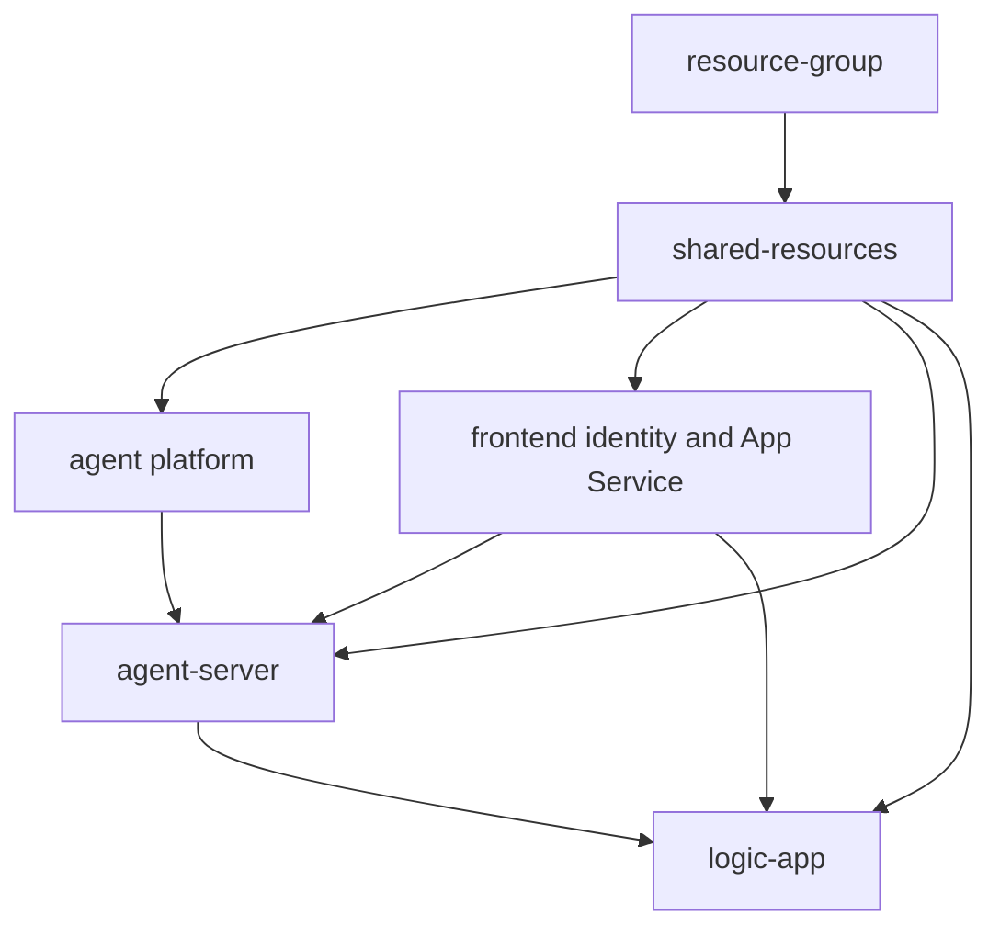
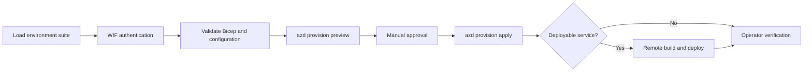
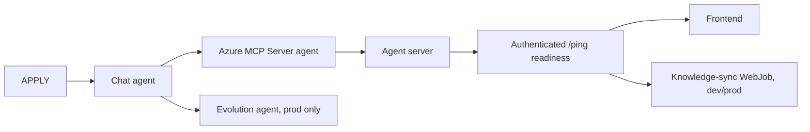
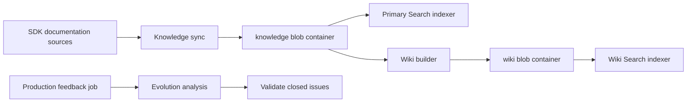

<!-- cspell:words postdeploy postprovision preprovision WIKIBLOB WIKIINDEX -->

# Deployment Architecture

This document explains the current executable deployment. The source of truth
is `tools/sdk-ai-bots/azure.yaml`, the Bicep entry points under
`deployment/infra/layers`, and the Azure DevOps orchestrators under
`deployment/pipelines`.

## System Components

- **`frontend`:** Teams bot on App Service. A user-assigned managed identity
  provides Azure Bot authentication.
- **`agent-server`:** Python API on App Service protected by Easy Auth. It
  resolves channel configuration, converts Teams activities, and hosts the
  scheduled knowledge-sync WebJob.
- **`agent`:** Microsoft Foundry hosted chat agent built remotely in ACR.
- **Azure MCP Server agent:** Separate Foundry hosted agent for the Azure MCP
  Server tenant.
- **`logic-app`:** Two Teams-group workflows share the agent-server, Teams
  connection, and integration account. Bicep owns both complete workflow
  definitions.
- **Evolution agent:** Production-only Foundry hosted agent with scoped access
  to production and candidate-dev resources.
- **Data jobs:** Knowledge sync runs as a scheduled WebJob on `agent-server`.
  Generated-wiki and feedback/evolution pipelines remain independent jobs.

Shared infrastructure includes ACR, Storage, Cosmos DB, Key Vault, App
Configuration, Azure AI Search, AI Services, Log Analytics, Application
Insights, alerts, and managed identities.

## Infrastructure Graph

The six Bicep layers are listed in `azure.yaml` in this order:

1. `resource-group`
2. `shared-resources`
3. `agent`
4. `frontend`
5. `agent-server`
6. `logic-app`

`dependsOn` is authoritative. `agent` and `frontend` can be provisioned after
shared resources; `agent-server` waits for both; and `logic-app` is last because
it consumes the deployed resource outputs.

## Pipeline Flow

The consolidated deployment pipeline follows the same control flow for
full-stack and component-scoped runs:

Application deployment follows a separate runtime dependency graph after the
infrastructure apply:

The Azure MCP Server agent follows the chat agent, and agent-server waits for
both hosted agents before frontend readiness. The readiness gate retries the
Easy Auth-protected `/ping` endpoint before the frontend and dev/prod WebJob
stages proceed. The production-only evolution branch does not gate frontend
deployment.

`qa-bot-deploy.yml` defaults to `component=all`. A component-scoped run
provisions the selected layer and its dependencies. Selecting `agent` deploys
both the chat agent and Azure MCP Server agent; selecting `frontend` deploys
only the frontend. Dev/prod `agent-server` deployments also update the
knowledge-sync WebJob, while preview deploys only the server. Selecting
`shared-resources` or `logic-app` provisions that infrastructure scope without
an application deploy. Component CI remains separate from provisioning and
deployment.

Both Logic Apps call the authenticated agent-server `/config/channel` endpoint
to resolve each channel's tenant. The backend reads
`bot-configs/channel.yaml` with the shared managed identity and caches the
parsed configuration. The shared managed identity authenticates the Logic App's
backend request and the backend's Blob read.

## Reconciled State

Some required state is not safely representable in Bicep and is reconciled by
lifecycle hooks:

- preprovision validates the environment contract, checks quota, detects local
  drift, and records the deployment principal;
- postprovision uploads per-environment bot routing, seeds the Search API key,
  reconciles Search objects, and seeds App Configuration;
- agent hooks reconcile Foundry settings, hosted identity, RBAC, and Entra
  authorization;
- frontend postdeploy probes `/health` and, when interactive Teams provisioning
  is enabled, installs or updates the approved Teams app in both configured
  groups;
- the knowledge-sync deployment stage packages and deploys the scheduled
  WebJob after agent-server readiness.

Application images use azd native remote Docker builds. After infrastructure
apply, the selected application deployment stage establishes runtime state and
postdeploy reconciliation as described in the [deploy runbook](https://github.com/Azure/azure-sdk-tools/blob/main/tools/sdk-ai-bots/deployment/docs/runbook-deploy.md).
Pipeline deployments skip interactive Teams provisioning by default; tenant
catalog publication and group installation require a Microsoft 365 session.

## Data Flows

Knowledge sync runs as the `knowledge-sync` scheduled WebJob on the
agent-server App Service and starts the primary Search indexer after writing
blobs. Wiki generation remains a scheduled pipeline and starts its own indexer.
The feedback pipeline operates independently of knowledge sync.

## Security Boundaries

- Azure DevOps uses workload identity federation; deployment secrets are not
  stored in pipeline YAML.
- Runtime workloads use managed identities and scoped data-plane roles.
- Deployment and developer principals are separate.
- The backend Entra application is bootstrapped outside unattended deployment;
  no client secret is created.
- Teams managed-API consent and first tenant catalog publication remain
  interactive operator actions.
- Dev permits local operations; preview and production use their mapped
  pipelines and service connections.

## Release and Recovery Model

- Normal layered preview operates on environments with existing layer state.
  Dev has a documented workstation bootstrap; a new preview or production
  environment requires an approved first-state bootstrap pipeline before its
  first normal deployment.
- Application rollout targets the production service resources directly.
  Release completion requires the endpoint, workflow, Teams, and telemetry
  checks in the [deploy runbook](https://github.com/Azure/azure-sdk-tools/blob/main/tools/sdk-ai-bots/deployment/docs/runbook-deploy.md).
- Code recovery redeploys the affected component from a known-good source
  revision. Data recovery follows the [rollback runbook](https://github.com/Azure/azure-sdk-tools/blob/main/tools/sdk-ai-bots/deployment/docs/runbook-rollback.md).

Continue with the [manual setup guide](https://github.com/Azure/azure-sdk-tools/blob/main/tools/sdk-ai-bots/deployment/docs/manual-setup.md).
