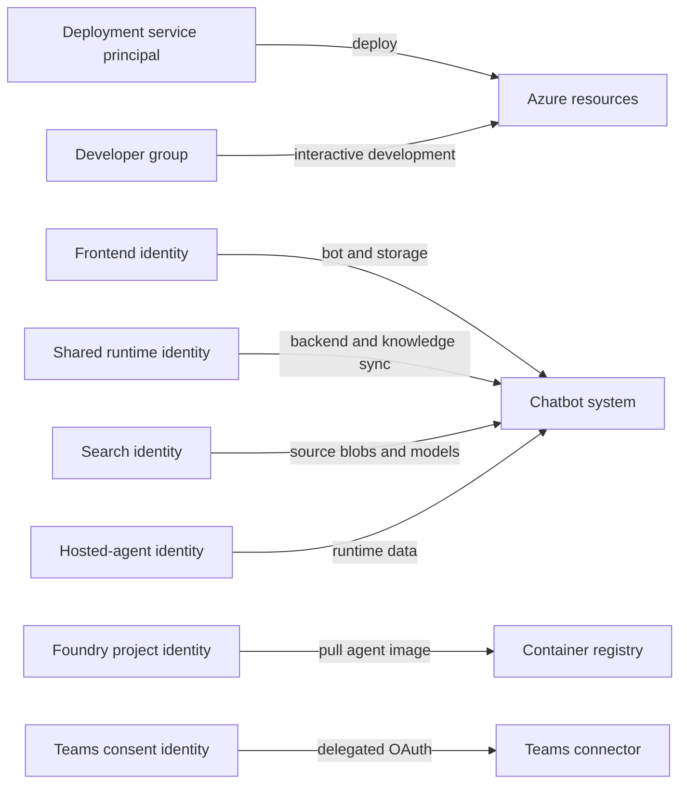

<!-- cspell:words appconfig appservice bicepparam qabot -->
<!-- cspell:words azuresdkqabot postdeploy postdeployment postprovision -->
<!-- cspell:words preauthorization preprovision -->

# Identity and Access Reference

This document describes authentication and authorization for the SDK AI chatbot
and its deployment system. It covers permissions declared in this repository.
Effective Azure access can also include assignments inherited from a
subscription, management group, resource group, or external tenant policy.

The [deployment process reference](https://github.com/Azure/azure-sdk-tools/blob/main/tools/sdk-ai-bots/deployment/docs/maintainer-guide.md#sources-of-truth) defines
file ownership. This reference is the canonical description of principals,
roles, consent, and grant lifecycles.

## Permission Planes

The system uses three authorization planes:

1. **Azure control plane:** create, configure, or delete Azure resources and
   Azure RBAC assignments. Bicep and `azd provision` operate primarily here.
2. **Service data plane:** read or write Blob, Table, Queue, App Configuration,
   Search, Cosmos DB, OpenAI, and Foundry data, and sign with the external
   GitHub App key in Key Vault.
3. **Entra and delegated authorization:** validate application tokens, assign
   application roles, install the Teams app, and authorize the Teams managed
   connector.

A control-plane `Contributor` role does not automatically grant service
`dataActions` or permission to create Azure RBAC assignments. Do not infer data
access from resource-management access.

## Identity Catalog

### Deployment principal

Azure DevOps selects an Azure Resource Manager service connection for each
environment through `pipelines/templates/service-connection.yml`.

| Environment | Deployment connection | Candidate-dev connection |
| --- | --- | --- |
| Dev | `qa-bot-dev` | Not used |
| Preview | `azuresdkqabot-preview` | Not used |
| Prod | `azuresdkqabot` | `azuresdkqabot-dev` |

Connection selection occurs at template expansion time. Authorize each pipeline
to use the selected connections in Azure DevOps, and verify their backing Azure
identities have the provisioning and runtime-role assignment permissions below.

Dev also declares the `qa-bot-dev` client application ID in
`AGENT_SERVER_ALLOWED_CLIENT_IDS` so backend readiness requests are accepted by
Easy Auth. The `agent-server` Bicep layer applies this configuration during
pipeline provisioning, before backend readiness checks, while retaining the
runtime, frontend, and Azure CLI callers. The administrator bootstrap does not
read or update backend authentication. Preview and production do not add this
dev caller.

[`azd-auth.yml`](https://github.com/Azure/azure-sdk-tools/blob/main/tools/sdk-ai-bots/deployment/pipelines/templates/azd-auth.yml) authenticates `az` and
`azd` through workload identity federation. It reads the object ID from the ARM
token and exports:

- `DEPLOYMENT_PRINCIPAL_ID`;
- `DEPLOYMENT_PRINCIPAL_TYPE=ServicePrincipal`.

The deployment principal creates resources, publishes images, deploys services,
runs hooks, seeds configuration, and creates role assignments. Its base
permission to manage resources and role assignments is configured on the Azure
DevOps service connection outside this repository. `Contributor` alone cannot
create role assignments; bootstrap normally also requires User Access
Administrator, Role Based Access Control Administrator, or Owner at an
appropriate parent scope.

The pipeline identity must never be copied into `DEVELOPER_PRINCIPAL_ID`.

### Developer principal

`DEVELOPER_PRINCIPAL_ID` and `DEVELOPER_PRINCIPAL_TYPE` identify the principal
for interactive development. The environment suite's `bicepOverrides` owns
this mapping. If no developer principal is
configured, developer role assignments are skipped. The preprovision hook does
not substitute the active deployment principal.

### Shared runtime identity

The shared-resources layer creates the `qabot-identity` user-assigned managed
identity and exports its client, object, and resource IDs. It is used by:

- the agent-server App Service through `AZURE_CLIENT_ID`;
- the Logic App's authenticated agent-server calls and Cosmos DB managed API
  connection.

It is attached to the agent-server together with the frontend identity, but the
agent-server and its knowledge-sync WebJob explicitly select the shared
identity for Azure SDK credentials. The App Service exposes the frontend
identity's client ID as `BOT_CLIENT_ID` so the WebJob can sign GitHub App tokens
with the externally managed Key Vault key.

### Frontend and bot identity

The frontend layer creates a separate user-assigned managed identity. The same
identity is used as:

- the frontend App Service runtime identity;
- the App Service container-pull identity;
- the Azure Bot Service `UserAssignedMSI` identity and bot client ID;
- an allowed Easy Auth caller for the agent-server;
- the frontend Blob and Table Storage identity.

Keeping this identity separate from `qabot-identity` prevents Bot Framework and
backend workload authorization from being conflated.

### Search service identity

Azure AI Search has a system-assigned identity. It reads source blobs and calls
AI Services for integrated vectorization and knowledge-base model operations.

### External GitHub signing vault

GitHub App authentication uses a non-exportable key in an externally managed
vault. Agents and knowledge sync select it through `GITHUB_APP_KEYVAULT_URL`;
the frontend uses `GITHUB_APP_KEY_VAULT_NAME`. Runtime identities use the key's
remote signing API to obtain GitHub App installation tokens.

The vault and key are external prerequisites, not resources provisioned by this
deployment. The private key is not retrieved or stored as a secret.

### Foundry project identity

The Foundry project has a system-assigned identity. It receives `AcrPull` on the
shared registry so the Foundry platform can pull hosted-agent images.

### Hosted-agent runtime identity

Foundry creates an `instance_identity` for a hosted-agent version. This identity
is not known during Bicep provisioning. Postdeployment code resolves its object
ID from the deployed version and grants the runtime roles described below.

A new hosted-agent version can have a different identity. Dynamic role grants
must therefore run after each hosted-agent deployment.

### Teams consent identity

The Teams Logic Apps connector uses delegated OAuth from the person or service
account that completes consent. Its token is stored in the managed connection's
ARM state. It is not one of the managed identities above.

The frontend Teams installation flow separately uses a Microsoft Graph token
for the signed-in account.

## Persistent Azure Roles

All listed scopes are resource scope unless noted otherwise.

### Shared runtime identity roles

Reconciled after the shared-resources layer by
[`resource-roles.ts`](https://github.com/Azure/azure-sdk-tools/blob/main/tools/sdk-ai-bots/deployment/hooks/lib/resource-roles.ts):

- **Storage Blob Data Owner**
  (`b7e6dc6d-f1e8-4753-8033-0f276bb0955b`) on Storage for Blob read, write, and
  delete operations.
- **Storage Queue Data Contributor**
  (`974c5e8b-45b9-4653-ba55-5f855dd0fb88`) on Storage for queue operations.
- **Storage Table Data Contributor**
  (`0a9a7e1f-b9d0-4cc4-a60d-0319b160aaa3`) on Storage for table and conversation
  state operations.
- **App Configuration Data Reader**
  (`516239f1-63e1-4d78-a4de-a74fb236a071`) on App Configuration.
- **Search Index Data Contributor**
  (`8ebe5a00-799e-43f5-93ac-243d3dce84a7`) on Search.
- **Search Service Contributor** on Search so the knowledge-sync WebJob can
  manage indexer operations.
- **Contributor** (`b24988ac-6180-42a0-ab88-20f7382dd24c`) and **AcrPull**
  (`7f951dda-4ed3-4680-a7ca-43fe172d538d`) on ACR.
- **Cosmos DB Built-in Data Contributor**
  (`00000000-0000-0000-0000-000000000002`) at the Cosmos account root. This is
  Cosmos SQL data-plane RBAC, not Azure RBAC.

The agent postprovision hook reconciles **Cognitive Services OpenAI User**
(`5e0bd9bd-7b93-4f28-af87-19fc36ad61bd`) and **Foundry User**
(`53ca6127-db72-4b80-b1b0-d745d6d5456d`) for the shared identity.

### Frontend identity roles

Reconciled by the frontend layer postprovision hook:

- **Monitoring Metrics Publisher**
  (`3913510d-42f4-4e42-8a64-420c390055eb`) on frontend Application Insights;
- **AcrPull** on the shared registry;
- **Storage Blob Data Contributor** on Storage;
- **Storage Table Data Contributor** on Storage.

The frontend uses managed identity and resource endpoints directly. It does not
retrieve storage account keys, so it does not require a management-plane
Storage role.

### Search identity roles

- **Storage Blob Data Reader**
  (`2a2b9908-6ea1-4ae2-8e65-a410df84e7d1`) on the shared storage account;
- **Cognitive Services User**
  (`a97b65f3-24c7-4388-baec-2e87135dc908`) on the AI Services account;
- **Cognitive Services OpenAI User**
  (`5e0bd9bd-7b93-4f28-af87-19fc36ad61bd`) on the AI Services account so Search
  can call embedding deployments when local authentication is disabled.

### Foundry project identity role

- **AcrPull** on the shared registry.

### Developer roles

When `DEVELOPER_PRINCIPAL_ID` is non-empty, the layer hooks reconcile:

- Storage Blob Data Contributor;
- App Configuration Data Reader;
- Contributor on ACR;
- Cosmos DB Built-in Data Contributor;
- Search Service Contributor
  (`7ca78c08-252a-4471-8644-bb5ff32d4ba0`);
- Cognitive Services OpenAI User;
- Foundry Project Manager
  (`eadc314b-1a2d-4efa-be10-5d325db5065e`).

These roles support local deployment, data inspection,
Search administration, and hosted-agent management.

### Deployment roles

The layer hooks reconcile the deployment principal's required access:

- Storage Blob Data Contributor for bot configuration upload;
- App Configuration Data Owner for configuration access and seeding;
- Contributor on ACR for remote builds and registry management;
- Search Service Contributor for Search control-plane operations;
- Cosmos DB Built-in Data Contributor for deployment and scheduled jobs;
- Cognitive Services OpenAI User;
- Foundry User for hosted-agent version creation and management.

Role reconciliation uses `DEPLOYMENT_PRINCIPAL_ID`, or resolves the active
Azure CLI caller when it is absent. It never substitutes
`DEVELOPER_PRINCIPAL_ID`. It skips matching direct or inherited roles and known
broader grants, and creates only missing assignments. Cosmos data grants are
checked separately through Cosmos SQL RBAC. Reconciliation never revokes
pre-existing roles.

Standalone hosted-agent deployment also reconciles the caller's App
Configuration and Foundry access before creating an agent version.

App Configuration seeding, bot configuration upload, and Search reconciliation are
explained in the [deployment process reference](https://github.com/Azure/azure-sdk-tools/blob/main/tools/sdk-ai-bots/deployment/docs/maintainer-guide.md#azd-hook-workflow).

## Dynamic Hosted-Agent Roles

### Chat agent

[`agent-postdeploy.ts`](https://github.com/Azure/azure-sdk-tools/blob/main/tools/sdk-ai-bots/deployment/hooks/agent-postdeploy.ts) grants the deployed chat
agent identity:

- App Configuration Data Reader, which is startup-critical;
- Cognitive Services OpenAI User;
- Foundry User;
- Storage Blob Data Owner;
- Storage Table Data Contributor;
- Storage Queue Data Contributor;
- Search Index Data Contributor.

Missing required resource names, identities, or failed runtime grants fail the
hook rather than reporting a successful deployment with incomplete access.

### Azure MCP Server agent

The shared hosted-agent deployment template writes the deployed
`AZURE_MCP_SERVER_AGENT_NAME` and `AZURE_MCP_SERVER_AGENT_VERSION` to App
Configuration, then grants the agent identity the primary access profile
defined by [`grant-agent-data-access.sh`](https://github.com/Azure/azure-sdk-tools/blob/main/tools/sdk-ai-bots/deployment/scripts/grant-agent-data-access.sh).
This includes the application data roles plus GitHub signing-vault and Cosmos
DB access required by its tools and memory provider.

The dev container registry, Search service, and AI Services account preserve
their pre-existing user-assigned identities. Fresh environments use the layer
defaults instead of inheriting these environment-specific identity maps.

The GitHub signing vault still uses legacy Key Vault access policies. Agent
access reconciliation checks for `Sign` and `Verify` there instead of creating
an Azure RBAC assignment; RBAC is used only when the target vault has
`enableRbacAuthorization=true`.

### Evolution agent

[`grant-agent-data-access.sh`](https://github.com/Azure/azure-sdk-tools/blob/main/tools/sdk-ai-bots/deployment/scripts/grant-agent-data-access.sh) defines two
profiles.

The **candidate** profile grants:

- App Configuration Data Reader;
- Storage Blob Data Contributor;
- Search Service Contributor;
- Search Index Data Contributor;
- Cognitive Services OpenAI User;
- Foundry User.

The **primary** profile adds:

- Monitoring Reader (`43d0d8ad-25c7-4714-9337-8ba259a9fe05`) on agent
  Application Insights;
- Key Vault Crypto User (`12338af0-0e69-4776-bea7-57ae8d297424`) on the GitHub
  signing vault;
- Cosmos DB Built-in Data Contributor.

The production evolution agent receives the primary profile in prod and the
candidate profile in the configured candidate environment, currently dev.
These grants are persistent for that hosted-agent identity.

## Application Authentication

### Teams to frontend

Azure Bot Service is configured with the frontend user-assigned identity. The
Teams manifest declares bot scope `team` and permissions `identity` and
`messageTeamMembers`.

The Teams Toolkit installation hook requires the signed-in account to have
Microsoft Graph `TeamsAppInstallation.ReadWriteForTeam`. Catalog policy,
tenant consent, and team membership are external to this repository.

### Frontend to agent-server

The agent-server is protected by App Service Easy Auth. Its Entra registration
is managed by [`create-entra-app.ts`](https://github.com/Azure/azure-sdk-tools/blob/main/tools/sdk-ai-bots/deployment/scripts/create-entra-app.ts), which
defines:

- delegated scope `access_as_user`;
- application role `access_as_application`;
- access-token version 2;
- Azure CLI preauthorization for interactive testing;
- optional caller application-role assignments.

Easy Auth permits tokens from the shared identity, frontend identity, and Azure
CLI application. The frontend requests the backend application's `.default`
scope and calls the server with that token.

### Runtime access

The agent-server and its knowledge-sync WebJob explicitly select the shared
runtime identity through `AZURE_CLIENT_ID`. The agent-server uses it to read
channel configuration from Blob Storage. The Logic App uses it for
authenticated agent-server calls and the Cosmos managed API connection, and
attaches the frontend identity for bot calls.

The Teams managed connector is different: it uses delegated OAuth. The
repository creates the connection shell and preserves a connected token, but
the connector and consenting account determine the exact delegated permission
set.

## Grant Lifecycle

| Grant class | Created by | Lifetime |
| --- | --- | --- |
| Runtime managed-identity roles | Layer postprovision hooks | Persistent |
| Developer roles | Layer postprovision hooks | Persistent |
| Deployment roles | Layer and seeding hooks | Persistent |
| Chat-agent runtime roles | Agent postdeploy hook | Agent identity lifetime |
| Evolution-agent roles | Agent deployment pipeline | Agent identity lifetime |
| Teams connector consent | Interactive operator | Until revoked or reset |
| Backend app roles | Entra setup script | Until explicitly removed |

Role assignments use resource scopes wherever the code controls the scope.
Subscription- or management-group-level assignments belong to service
connection bootstrap and organizational governance, not these Bicep layers.

## Security Invariants

- Keep deployment and developer principal inputs separate.
- Never default `DEVELOPER_PRINCIPAL_ID` to the authenticated pipeline identity.
- Use workload identity federation; do not add service-connection secrets.
- Scope role assignments to the smallest resource that supports the operation.
- Do not replace managed identity with storage keys or service API keys unless a
  service integration explicitly requires one.
- Do not commit `.azure/<environment>/.env`; it is local azd state.
- Treat App Configuration Data Owner, Search Service Contributor, Foundry Project Manager,
  and role-assignment permissions as privileged grants.
- Preserve the Teams managed connection after consent; replacing it can discard
  delegated OAuth state.
- Reapply hosted-agent roles after creating a new hosted-agent identity.

## Verify Access

Use `az role assignment list` and `az cosmosdb sql role assignment list` for
read-only verification against a deployed environment. Include
`--include-inherited` when evaluating effective Azure RBAC. Do not infer the
state of production solely from Bicep because adopted resources can have
pre-existing or out-of-band assignments.
