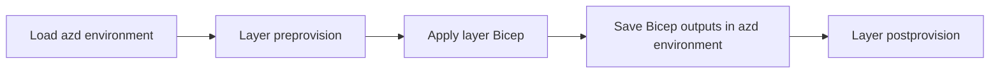
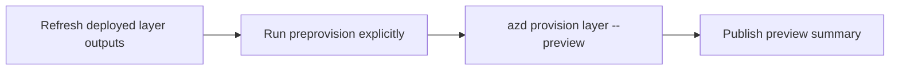
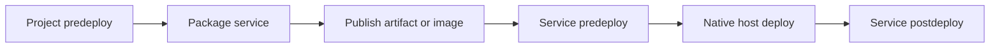

<!-- cspell:words appconfig bicepparam postdeploy postprovision -->
<!-- cspell:words predeploy preprovision -->

# Deployment Process Reference

This reference describes pipeline execution, lifecycle hooks, and image
selection in the active SDK AI bot deployment. For step-by-step deployment or
incident recovery, use the
[deploy runbook](https://github.com/Azure/azure-sdk-tools/blob/main/tools/sdk-ai-bots/deployment/docs/runbook-deploy.md) or [rollback runbook](https://github.com/Azure/azure-sdk-tools/blob/main/tools/sdk-ai-bots/deployment/docs/runbook-rollback.md).
For the deployed topology, start with the
[deployment architecture](https://github.com/Azure/azure-sdk-tools/blob/main/tools/sdk-ai-bots/deployment/docs/deployment-architecture.md).
For principal ownership and role scopes, use the
[identity and access reference](https://github.com/Azure/azure-sdk-tools/blob/main/tools/sdk-ai-bots/deployment/docs/identity-and-access.md).

The project currently requires azd `>=1.32.0` and pins the
`azure.ai.agents` extension in `azure.yaml`. Install the required extension
before provisioning or deploying hosted agents.

## Sources of Truth

Use these files to identify the desired configuration and deployment steps:

- **Services, layer graph, hooks, and tool versions:**
   `tools/sdk-ai-bots/azure.yaml`
- **Subscription IDs, locations, resource names, routing, and health paths:**
   `deployment/infra/environments/environment-suite.yaml`
- **Azure resource shape and base configuration:**
   `deployment/infra/layers/<layer>/main.bicep`
- **Mapping azd values into Bicep parameters:**
   `deployment/infra/layers/<layer>/main.bicepparam`
- **Data-plane and post-deployment reconciliation:** `deployment/hooks/`
- **Preview, approval, apply, deployment order, and authentication:**
   `deployment/pipelines/`
- **Local validation and operator utilities:** `deployment/scripts/`

`environment-suite.yaml` is canonical configuration. Local azd state is derived
from it by `scripts/sync-env-suite.ts`; pipeline variables are derived from it
by `pipelines/templates/load-environment-suite.yml`. Local azd state under
`.azure/<environment>` is generated state and must not be committed.

## Execution Model

The unified entry point is
`deployment/pipelines/orchestrators/qa-bot-deploy.yml`. It accepts an
environment, a deployment component, and an optional image tag.

Infrastructure execution follows this path:

```text
qa-bot-deploy.yml
  -> provision-with-approval.yml
     -> provision-stage.yml (preview)
     -> approval-stage.yml
     -> provision-stage.yml (apply)
        -> azd-provision.yml
           -> azd provision [<layer>]
```

Application execution follows this path:

```text
qa-bot-deploy.yml
  -> deploy-stage.yml or provision-and-deploy-component.yml
     -> component-deploy-stage.yml
        -> azd-deploy.yml
           -> azd deploy <service>
```

A pipeline job starts without local azd state. The templates therefore load the
environment suite, authenticate with workload identity federation, select or
create the azd environment, and refresh required layer outputs before invoking
azd. Removing an `azd env refresh` call can break resource discovery even when
the resource exists in Azure.

For adopted resource names, identities, policies, model capacities, registry
ownership, and the dev App Service target, use the
[environment contract](https://github.com/Azure/azure-sdk-tools/blob/main/tools/sdk-ai-bots/deployment/docs/environment-contract.md). Compare those values with the
target resource state before approving a preview.

Full-stack application deployment is a graph, not a serial list. `agent` starts
after provisioning. The Azure MCP Server agent follows `agent`; `agent-server`
waits for both hosted agents; and `frontend` plus the dev/prod knowledge-sync
WebJob wait for an authenticated agent-server `/ping` readiness probe. The
production-only evolution agent also waits for `agent`, but runs independently
of the agent-server/frontend branch. Preserve these runtime dependencies unless
the producer-consumer contract changes.

The pipeline always publishes a Bicep/configuration preview before apply and
uses a manual approval stage. The approval task expires after 24 hours and the
stage after three days. Logic App provisioning verifies the Teams managed
connection and requests delegated consent before the deployment can complete.

Knowledge sync is deployed as a scheduled WebJob with the dev/prod
agent-server path. Wiki generation and feedback/evolution remain data jobs
outside the azd service graph.

## azd Hook Workflow

An azd hook is a script registered at a lifecycle point in `azure.yaml`. A file
under `deployment/hooks/` does nothing by itself; its registration determines
when it runs, its scope, and its working directory. See the official
[azd hooks documentation](https://learn.microsoft.com/azure/developer/azure-developer-cli/azd-extensibility)
for the complete extension model.

This project uses three hook scopes:

- **Project hooks** under the root `hooks` block wrap an azd command. The only
   provision/deploy hook at this scope is `predeploy`.
- **Layer hooks** under `infra.layers[].hooks` wrap the Bicep apply for one
   infrastructure layer.
- **Service hooks** under `services.<name>.hooks` wrap the final deployment
   operation for one application service.

All current hooks declare `interactive: true` and do not set
`continueOnError`. An unhandled hook failure therefore fails the azd command
and prevents later lifecycle steps. A few hooks deliberately catch selected
errors and log warnings when the underlying deployment is still usable.

### `azd provision`

For an apply, azd resolves the selected layer graph from `dependsOn`. Each
layer then follows this lifecycle:



The dependency graph is authoritative. Independent layers can be scheduled
without relying on their textual order in `azure.yaml`, so hooks must consume
only declared dependency outputs.

The pipeline preview path is intentionally different:



Native `azd provision --preview` skips hooks and does not update environment
outputs. `azd-provision.yml` explicitly runs the selected layer's
`preprovision` hook before each preview because guards and preservation flags
must still be evaluated. It never runs `postprovision` during preview because
those hooks mutate Azure data-plane state.

The registered provision hooks are:

- **`resource-group` preprovision: `preprovision.ts`.** Checks required tools,
   validates the environment-suite name, detects local azd environment drift,
   enforces `localDeployAllowed`, checks quota, and records the active deployment
   principal. Bicep cannot inspect local tools, compare local azd
   state with repository configuration, query quota safely, or derive the
   caller identity from the current Azure CLI token.
- **Shared, agent, frontend, and agent-server preprovision:
   `layer-preprovision.ts`.** Enforces the selected environment's local
   operation policy immediately before each layer apply. The repeated layer
   registration also protects a targeted `azd provision <layer>` that does not
   execute `resource-group`.
- **Agent postprovision: `agent-postprovision.ts`.** Creates or adopts the
   Foundry User role assignment for the shared managed identity.
- **Frontend postprovision: `frontend-postprovision.ts`.** Generates the Teams
   Toolkit `env/.env.azd` file from committed Teams settings and the newly
   captured Bicep outputs. Teams Toolkit configuration is not an ARM resource,
   and the required values do not all exist until this layer completes.
- **Logic App preprovision: `logic-app-preprovision.ts`.** Discovers and
   preserves an existing Teams managed API connection and checks its OAuth
   status. It writes flags that tell Bicep to create or repair a connection,
   preserve a connected one, and enable the workflow only after consent. This
   probe is required to avoid replacing delegated OAuth state.
- **Logic App postprovision: `postprovision.ts`.** Uploads per-environment bot
   routing, seeds Key Vault and App Configuration, and reconciles Azure AI
   Search data-plane objects after the final layer outputs exist. These are
   data-plane and content operations rather than ARM resource declarations.
   Despite its generic filename, this is a Logic App layer hook, not a root
   project hook; it does not run when another layer is provisioned by itself.

### `azd deploy <service>`

For a standalone service deployment, azd uses this high-level sequence:



The project hook wraps the whole command. Service hooks wrap the final deploy
phase, so package or publish work may already have happened before a service
`predeploy` hook starts. This distinction matters when changing image logic.
The Azure DevOps orchestrator invokes one service per `azd deploy` command and
owns the cross-service order; do not rely on an unscoped local `azd deploy` to
match that pipeline sequence.

The registered deploy hooks are:

- **Project predeploy: `predeploy.ts`.** Runs for every service and rejects a
   local deploy when the selected environment disables it. Native azd knows how
   to deploy a service but does not own this release policy.
- **Frontend postdeploy: `frontend-postdeploy.ts`.** Runs Teams Toolkit
   provisioning, publishes when requested or when installation drift exists,
   installs or upgrades the app in the configured team through Microsoft Graph,
   and probes `/health`. Teams catalog and Graph operations are outside ARM and
   native azd. The pipeline normally sets `AZD_SKIP_TEAMS_PROVISION=1`; local
   interactive runs can perform the Teams work. Teams failures and health
   timeout are warnings unless strict Teams mode is enabled.
- **Agent postdeploy: `agent-postdeploy.ts`.** Grants the newly created hosted
   agent identity its data-plane roles, ensures the latest Foundry agent version
   contains `AZURE_APPCONFIG_ENDPOINT`, and probes `/ping`. The hosted identity
   and version are created during deployment, so their principal ID and version
   definition are unavailable to Bicep beforehand.

Frontend and `agent-server` have no custom predeploy hook. They use azd's native
package, remote publish, and container deployment lifecycle; the frontend
Dockerfile compiles TypeScript inside the remote build. `agent` also has no
predeploy hook; azd and the `azure.ai.agents` extension own its image build and
initial Foundry deployment before `agent-postdeploy.ts` reconciles runtime
state. The deployment pipeline separately packages and deploys the
knowledge-sync WebJob after agent-server readiness.

### Rerunning a Hook

To rerun one hook in dev, use `azd hooks run <hook> --layer <layer> -e dev` or
`azd hooks run <hook> --service <service> -e dev`. This executes the hook's
real side effects without running the wrapped Bicep or service action, so use
it only against an intended environment.

## Image Version Flow

`qa-bot-deploy.yml` exposes `imageTag` as an optional override. Its default,
`auto`, selects the component's automatic tag strategy; any other value is
validated and used by every selected application image. The `Show image
version` step runs before the build or deployment.

The handoff is:

1. `azd-deploy.yml` resolves or accepts the tag and sets `AZD_IMAGE_TAG`.
2. `azure.yaml` uses `AZD_IMAGE_TAG` as `docker.tag` for all three azd-managed
   container builds.
3. Agent postdeploy independently reconstructs the selected chat-agent image
   from the ACR endpoint, environment name, and `AZD_IMAGE_TAG` before it clones
   a Foundry version to inject runtime environment variables.
4. The Azure MCP Server and evolution-agent deployments pass their selected tag to
   `deploy_hosted_agent.py`.

Record the image version shown before each deployment. Frontend automatic tags
derive from existing ACR tags; azd-managed agent and agent-server deployments
use a build-based tag when no override is supplied.

## Operational Boundaries

- Never hard-code an environment-specific subscription, resource name, endpoint,
  or image tag in `azure.yaml`, Bicep, hooks, or pipeline templates.
- Keep `DEVELOPER_PRINCIPAL_ID` configuration-owned. Never default it to the
  deployment principal; omitted developer identity means skip developer roles.
- Preview and apply must use the same Bicep entry point and parameter adapter.
- Re-provisioning can restore placeholder container images. The matching
  application deploy must run afterward.
- Production is pipeline-only. Do not weaken the provision guard to debug a
  production issue locally.
- `.azure/` contains machine-local state. Never use it as review evidence or
  commit it.
- Keep wiki generation and feedback processing outside the azd service graph.
  Knowledge sync is a WebJob coupled to the agent-server deployment path.

## azd References

- [Azure Developer CLI overview](https://learn.microsoft.com/azure/developer/azure-developer-cli/overview)
- [Azure Developer CLI command reference](https://learn.microsoft.com/azure/developer/azure-developer-cli/reference)
- [Azure Developer CLI template structure](https://learn.microsoft.com/azure/developer/azure-developer-cli/azd-templates)
- [Work with azd environment variables](https://learn.microsoft.com/azure/developer/azure-developer-cli/manage-environment-variables)
- [Customize azd workflows with hooks](https://learn.microsoft.com/azure/developer/azure-developer-cli/azd-extensibility)
- [`azure.yaml` schema reference](https://github.com/Azure/azure-dev/blob/main/docs/reference/azure-yaml-schema.md)
- [Azure Developer CLI source and issues](https://github.com/Azure/azure-dev)
