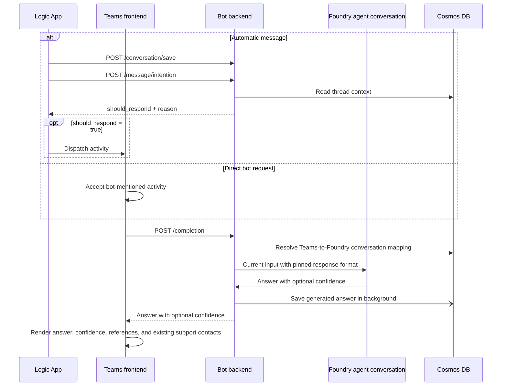

# Confidence-Aware Teams Chatbot

**Status:** Implemented; rollout pending

| Issue | Behavior |
| --- | --- |
| [Azure/azure-sdk-pr#2964](https://github.com/Azure/azure-sdk-pr/issues/2964) | Show the answering model's confidence and unresolved needs without suppressing useful guidance. |
| [Azure/azure-sdk-pr#2965](https://github.com/Azure/azure-sdk-pr/issues/2965) | Allow intention classification to approve appropriate new questions after humans join a thread. |

Expert mention and support-contact behavior is implemented separately by [Azure/azure-sdk-tools#17453](https://github.com/Azure/azure-sdk-tools/pull/17453).

## Responsibilities

| Responsibility | Owner |
| --- | --- |
| Decide whether the bot should participate automatically | Existing intention classifier before generation |
| Generate the answer and confidence assessment | Existing answering agent |
| Display confidence details | Teams frontend |

Confidence is the model's assessment of the guidance it actually provides, not a verified correctness grade, probability, or separate evaluator score.

Low confidence never suppresses a generated answer.

## Workflow



## Configuration

The existing `bot-configs/channel.yaml` blob stores the optional per-channel settings.

```yaml
channels:
  - id: channel-1
    tenant: api_spec_review_bot
    bot_settings:
      show_confidence_label: false
      allow_replies_after_humans: false
```

| Setting | Default | Effect |
| --- | --- | --- |
| `show_confidence_label` | `false` | Request assessed answers for new posts and display the confidence label. |
| `allow_replies_after_humans` | `false` | Let intention classification consider new questions after humans join. |

Missing settings preserve existing behavior.

Backend retrieval failures log the error and use all-off defaults without caching the failed result.

The frontend reuses `ChannelConfigManager`, so no per-answer configuration request is added.

## Conversation format

New Teams posts pin `confidence_enabled` in the existing conversation mapping.

Existing mappings without the field default to plain Markdown responses.

Enabling confidence later affects new posts only, while an existing post keeps its original format across replies and recovery.

When confidence is enabled, the first invocation adds `answer_confidence.md` to the normal tenant instructions.

The answering agent returns:

```json
{
  "answer": "Useful guidance, limitations, and references.",
  "confidence": {
    "level": "medium",
    "summary": "The rerun steps are supported, but the exception criteria remain unclear.",
    "unresolved_needs": ["Confirm whether this failure qualifies for an exception."]
  }
}
```

`AssessedAnswer` is an internal model-output envelope.

The public response keeps the existing answer fields and adds optional `confidence`.

If JSON or schema validation fails, the backend logs a warning, preserves a string `answer` field when available, and returns no confidence rather than fabricating a Low score.

## Continued replies after humans join

The existing intention service remains the sole automatic participation gate.

Without opt-in, the existing human-presence checks still stop automatic replies.

With `allow_replies_after_humans=true`, human participation alone does not stop classification.

The classifier should answer independent technical questions but remain silent when a human is already handling the same question or when the request requires human approval or authority.

Direct bot mentions continue to bypass automatic intention classification.

## Persistence and limits

Foundry conversations remain the normal answering context.

Cosmos thread messages remain the context for intention classification and exceptional broken-conversation recovery.

The frontend continues saving successful prompt and reply activities to Table Storage.

Human messages stored only in Cosmos are not automatically synchronized into the Foundry conversation, so the answering agent may need to ask for missing context.

Conversation mapping creation remains create-if-absent so the first saved conversation ID and response format win concurrent initialization.
